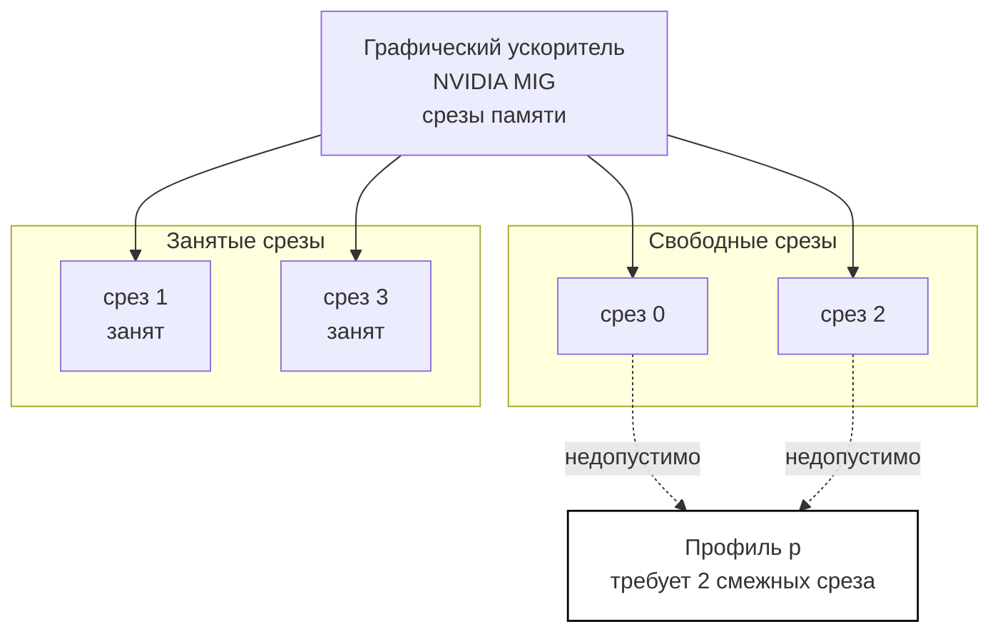
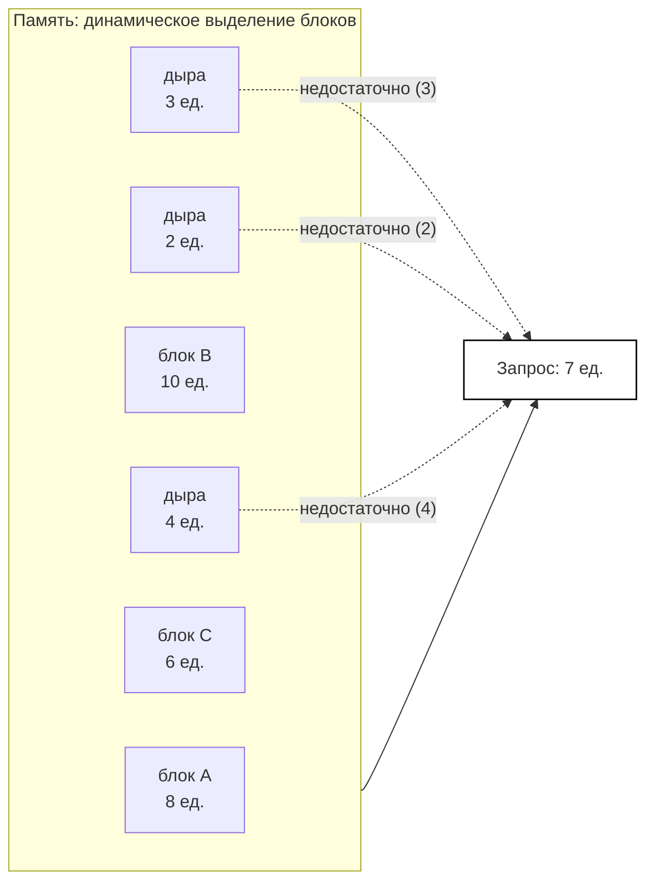

# Глава 1. Фрагментация и политики управления ресурсами

Настоящая глава открывает диссертацию центральной темой управления ресурсами вычислительного кластера — фрагментацией. Рассматривается феномен фрагментации как причины потери эффективной ёмкости [4, 14], вводятся понятия виртуальной машины как средства управления ресурсами [13], анализируются политики вытеснения и невытеснения [22, 23], а также приводится классический результат Кнута о 50%-фрагментации [[14-knuth|14]]. Полученные представления образуют фундамент для модели справедливого разделения эластичной ёмкости (глава 3) и алгоритмов размещения (глава 4).

## 1.1 Фрагментация как центральная проблема управления ресурсами

Центральной проблемой управления ресурсами вычислительного кластера является фрагментация — явление, при котором свободная ёмкость системы оказывается распределённой по множеству малых, не используемых одновременно фрагментов, вследствие чего суммарно достаточный объём свободных ресурсов не может быть предоставлен ни одной вновь поступающей нагрузке. Фрагментация рассматривается в классических работах по управлению памятью и задаче упаковки в контейнеры [4, 14].

Различают внешнюю и внутреннюю фрагментацию. Внешняя фрагментация возникает, когда свободная память (или иной ресурс) разбита на отдельные области, ни одна из которых не достаточна для размещения новой задачи, хотя их суммарный объём это позволяет. Внутренняя фрагментация возникает при выделении ресурса блоками фиксированного размера, когда часть выделенного блока остаётся неиспользуемой [23].

Статистический анализ процессов фрагментации показывает, что образующиеся при этом фрагменты имеют существенно неоднородное распределение размеров. В работе [[48-random-trees|48]] исследована фрагментация случайного рекурсивного дерева, распадающегося на лес при последовательном удалении узлов: показано, что плотность распределения размеров фрагментов $\varphi_s$ имеет степенной хвост $\varphi_s \sim s^{-\alpha}$ с показателем $\alpha = 1 + 1/m$, где $m$ — доля оставшихся узлов. Иными словами, по мере фрагментации структуры возникает множество разноразмерных осколков, а показатель степенного хвоста меняется со временем. Эта закономерность подтверждает, что фрагментация порождает гетерогенное множество фрагментов разного размера, — обстоятельство, которое затрудняет плотное размещение нагрузки и усиливает потери эффективной ёмкости, рассматриваемые в разделе 1.4.

В вычислительном кластере с множественной арендой ресурсов фрагментация приводит к снижению эффективной ёмкости: даже при наличии свободного места в целом по кластеру требуемая нагрузка не может быть размещена ни на одном узле. Таким образом, фрагментация непосредственно влияет на ключевые показатели кластера — утилизацию, пропускную способность и справедливость распределения ресурсов между владельцами. Понимание природы фрагментации и способов борьбы с ней является необходимым условием разработки эффективных механизмов управления ресурсами, рассматриваемых в последующих главах.

Современная иллюстрация фрагментации возникает в облаках с множественной арендой при аппаратном разделении графического ускорителя на изолированные срезы технологии NVIDIA Multi-Instance GPU (MIG) [[40-mig-fragmentation|40]]. Жёсткие ограничения MIG (набор допустимых профилей, требования к смежности срезов, фиксированные индексы размещения) приводят к тому, что ускоритель считается фрагментированным относительно профиля $p$, если тот нельзя разместить при достаточном суммарном объёме свободных срезов. В работе [[40-mig-fragmentation|40]] вводится метрика фрагментации

$$F(m) = \sum_{p \in P_m} \sum_{\bar{\imath} \in I_p} r^{mem}_p \cdot \mathbb{1}\left\{ \text{размещение } p \text{ на индексе } \bar{\imath} \text{ недопустимо} \right\},$$

где $P_m$ — множество поддерживаемых ускорителем $m$ профилей, $I_p$ — множество допустимых индексов размещения профиля $p$, а $r^{mem}_p$ — число срезов памяти, составляющих профиль $p$. Метрика позволяет сравнивать степень фрагментации разных ускорителей и направляет выбор размещения. На её основе построен онлайн-алгоритм минимального прироста фрагментации (Minimum Fragmentation Increment), выполняющий «сухое» размещение на каждом ускорителе и выбирающий вариант с наименьшим приращением $F(m)$; он работает без априорного знания о распределении профилей и повышает число принятых нагрузок в среднем на 10 % в условиях высокой загрузки [[40-mig-fragmentation|40]]. Этот пример показывает, что фрагментация — не только классическая проблема управления памятью [[14-knuth|14]], но и актуальный практический вопрос планирования гетерогенных ускорителей, что усиливает мотивацию эластичного размещения в настоящей работе.

Проиллюстрируем фрагментацию ускорителя в технологии MIG. Ускоритель разделяется на изолированные срезы фиксированной ёмкости, а профиль $p$ занимает заранее заданное число срезов памяти с требованием смежности и фиксированных индексов размещения. Если свободные срезы разбросаны по ускорителю, профиль может оказаться неразместимым, несмотря на достаточный суммарный объём свободной памяти (рис. 1.1).

<small>Рис. 1.1. Фрагментация ускорителя в MIG: профиль $p$ не размещается из-за разброса свободной памяти (по [[40-mig-fragmentation|40]]).</small>

## 1.2 Виртуальные машины как средство управления ресурсами

Эффективным способом организации управления ресурсами вычислительной системы является виртуализация: изоляция вычислительных ресурсов и предоставление их приложениям через абстракцию виртуальной машины. Виртуальная машина инкапсулирует состояние исполняемой программы, модули среды выполнения и механизмы выделения ресурсов, что позволяет централизованно управлять потреблением ресурсов и согласовывать работу нескольких сред исполнения.

Формальная модель состояния виртуальной машины предложена в работе [13]. Состояние виртуальной машины описывается кортежем

$$S = \langle C, R, M, P, F \rangle,$$

где $C$ — исполняемая программа, $R$ — состояние регистров и памяти, $M$ — внутренние модули (например, сборщик мусора, компилятор времени исполнения), $P$ — приоритет в рамках операционной системы, $F$ — флаг состояния программы (wait, ready, run). Взаимодействие между виртуальными машинами $A$ и $B$ описывается средой взаимодействия

$$I = \langle Q_{A \to B}, Q_{B \to A}, E \rangle,$$

где $Q_{A \to B}$ и $Q_{B \to A}$ — очереди сообщений с вызовами, а $E$ — протокол работы с общими данными.

В работе [13] установлено следующее утверждение о времени совместной работы нескольких виртуальных машин.

**Утверждение 1.1 (декомпозиция времени работы виртуальной машины [13]).** Суммарное время совместной работы виртуальных машин $A$ и $B$ равно

$$T_{\Sigma} = T_A + T_B + T_I,$$

где $T_A$, $T_B$ — времена работы виртуальных машин $A$ и $B$ соответственно, а $T_I$ — время, необходимое на взаимодействие между ними. Время работы каждой виртуальной машины, в свою очередь, представимо в виде

$$T_{VM} = T^{C}_{VM}(C, M) + T^{M}_{VM}(C, M),$$

где $T^{C}_{VM}$ — время выполнения пользовательской программы, а $T^{M}_{VM}$ — время, затраченное на работу внутренних модулей (например, паузы на сборке мусора).

Декомпозиция показывает, что неэффективное управление ресурсами внутренних модулей (в первую очередь сборщика мусора и компилятора времени исполнения) непосредственно увеличивает время работы виртуальной машины. Следовательно, согласованное централизованное управление ресурсами нескольких виртуальных машин — задача, значимость которой подтверждается необходимостью координации конкурирующих за ресурсы подсистем.

Для оценки эффективности совместного выполнения виртуальных машин в работе [13] получена оценка времени параллельного выполнения в условиях гетерогенной архитектуры.

**Утверждение 1.2 (время параллельного выполнения на гетерогенном наборе ядер [13]).** Пусть набор потоков-исполнителей $P = \{p_0, \dots, p_{N-1}\}$ упорядочен по невозрастанию производительности, а относительные производительности ядер задаются коэффициентами $n_i = p_i / p_0 \in (0, 1]$. Тогда время параллельного выполнения вычислений ограничено сверху величиной

$$T_N \leq \frac{T_1}{\sum_{i=1}^{N-1} n_i + 1} + O\left(\frac{T_{\infty}}{n_{N-1}}\right),$$

где $T_1$ — время однопоточного выполнения, а $T_{\infty}$ — критический путь вычисления.

Из этой оценки следует, что эффективность распараллеливания убывает по мере привлечения всё более слабых ядер: предельная ёмкость, доступная подсистеме, зависит не только от числа исполнителей, но и от их относительной производительности. Применительно к управлению ресурсами это означает, что выделение ёмкости должно учитывать неоднородность вычислительного оборудования.

## 1.3 Политики вытеснения и невытеснения

Управление ресурсами предполагает выбор политики доступа к вычислительной ёмкости. Различают политики невытеснения (non-preemptive) и вытеснения (preemptive).

При **невытесняющей** политике задача, получившая ресурсы, исполняется до своего завершения либо до явного освобождения ресурсов; запущенные задачи не прерываются по требованию планировщика [23]. Такая политика проста в реализации, не вносит накладных расходов на сохранение и восстановление состояния задач, однако может приводить к голоданию низкоприоритетных задач и ухудшению гарантий времени отклика. Классическими примерами являются невытесняющее планирование с выбором кратчайшей работы первым (shortest job first) [[22-sjf-many-server|22]] и планирование без прерываний в реальном времени.

При **вытесняющей** политике планировщик вправе прервать исполняемую задачу и передать ресурсы другой задаче с более высоким приоритетом [23]. Вытеснение обеспечивает лучшие гарантии времени отклика для приоритетных задач и предотвращает их голодание, но связано с накладными расходами на переключение контекста и сохранение состояния. Примерами являются вытесняющее приоритетное планирование и планирование с квантованием времени (round-robin). В системах с ограниченной памятью вытеснение проявляется как вытеснение страниц памяти (eviction), например, по алгоритму LRU (least recently used) [23].

В контексте эластичной нагрузки вытесняющая политика приобретает особую форму: вместо полного прерывания задачи планировщик может сжать её ресурсы в пределах диапазона эластичности $[x_{\min}, x_{\max}]$, высвобождая ёмкость для более приоритетной нагрузки без полного вытеснения. Такой подход сочетает преимущества вытеснения (приоритизация, отсутствие голодания) с меньшими накладными расходами, поскольку не требует прерывания и последующего перезапуска задачи. Выбор между политиками вытеснения и невытеснения, а также способ использования эластичности при вытеснении, существенно влияет на справедливость распределения ёмкости между владельцами, что рассматривается в главе 4.

## 1.4 Правило Кнута и 50%-фрагментация

Количественную оценку потерь ёмкости от внешней фрагментации даёт классический результат Кнута [[14-knuth|14]]. В условиях динамического выделения блоков переменного размера со случайными размерами запросов внешняя фрагментация приводит к образованию свободных «дыр», часть которых не может быть использована для размещения новых запросов.

**Утверждение 1.3 (правило Кнута о 50%-фрагментации [[14-knuth|14]]).** При случайном поступлении запросов на выделение блоков переменного размера среднее число свободных «дыр», образующихся вследствие фрагментации, составляет примерно половину от числа выделенных блоков. Следствием этого является потеря значительной доли ёмкости — порядка $\tfrac{1}{2}$ — из-за внешней фрагментации при отсутствии мер по её устранению.

Правило Кнута описывает типичную ситуацию при наивном (например, случайном) распределении памяти и не является точной гарантией для произвольного распределения размеров запросов; оно отражает эмпирическую закономерность, характерную для широкого класса сценариев динамического выделения ресурсов. Тем не менее оно служит важной мотивировкой для методов борьбы с фрагментацией: если не предпринимать специальных мер, существенная доля ёмкости кластера может оказаться недоступной для размещения нагрузки.

Механизм образования свободных «дыр» иллюстрируется на рисунке 1.2: при динамическом выделении блоков переменного размера занятые блоки разделяют память на отдельные свободные промежутки, суммарный объём которых достаточен для нового запроса, но ни один из них не подходит по размеру.

<small>Рис. 1.2. Правило Кнута: занятые блоки разделяют память на «дыры» достаточного суммарного, но не подходящего по размеру объёма, доля потерянной ёмкости $\approx 1/2$.</small>

Применительно к вычислительному кластеру правило Кнута означает, что наивное размещение нагрузки по узлам способно снижать эффективную ёмкость кластера вплоть до половины его номинальной ёмкости. Это обосновывает необходимость использования стратегий уплотнения (плотной упаковки) и эластичного размещения, позволяющих сокращать потери от фрагментации. Учёт этих стратегий в модели справедливого разделения ёмкости рассматривается в главах 3 и 4.

## 1.5 Заключение главы 1

В главе открыта центральная тема диссертации — фрагментация как причина потери эффективной ёмкости вычислительного кластера. Показано, что виртуальные машины являются эффективным средством изоляции и централизованного управления ресурсами; приведены заимствованные из работы [13] утверждения о декомпозиции времени работы виртуальной машины и об оценке времени параллельного выполнения на гетерогенном наборе ядер. Проанализированы политики вытеснения и невытеснения и показана их связь с эластичностью нагрузки. Рассмотрено правило Кнута о 50%-фрагментации [[14-knuth|14]], количественно обосновывающее потери ёмкости при наивном размещении.

Фрагментация и способы борьбы с ней определяют постановку задачи справедливого разделения эластичной ёмкости кластера: математическая модель строится в главе 3, алгоритмы размещения — в главе 4, теоретико-игровой анализ — в главе 5, экспериментальная оценка — в главе 6.