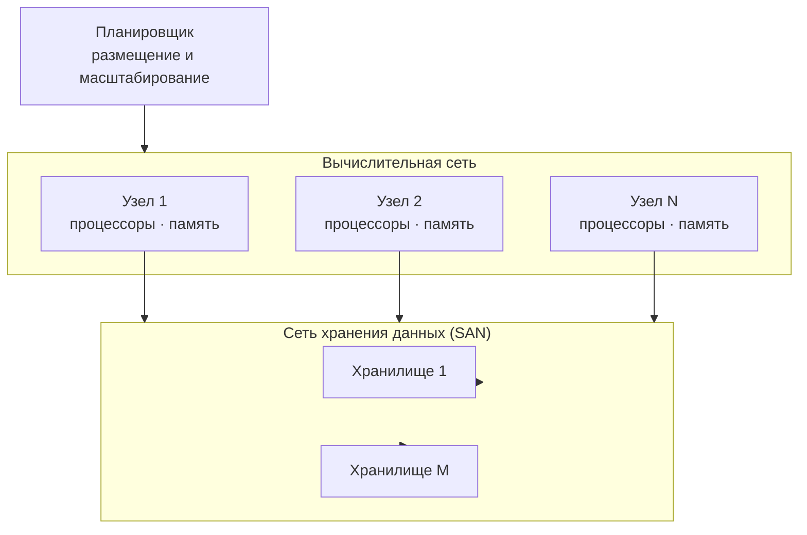
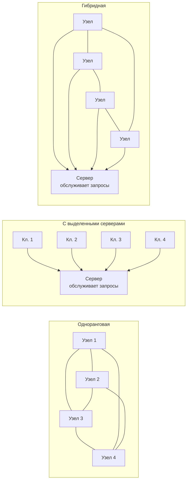
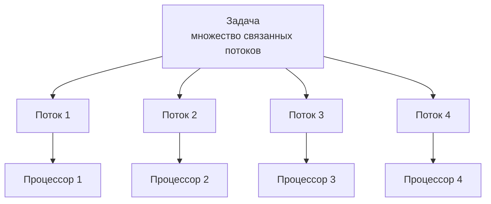

# Глава 2. Обзор подходов к распределению ресурсов в вычислительных кластерах

В настоящей главе рассматривается современное состояние исследований в области управления вычислительными кластерами с множественной арендой ресурсов. Последовательно вводятся понятия облачной модели и эластичности нагрузки, описываются существующие планировщики ресурсов, механизмы справедливого распределения и квотирования, задачи упаковки нагрузки и её стохастические обобщения, а также теоретико-игровые модели кооперативного использования ресурсов. По результатам обзора формулируются нерешённые задачи, которые мотивируют постановку проблемы в главе 3.

## 2.1 Модель облачных вычислений и множественная аренда ресурсов

Облачные вычисления представляют собой модель предоставления вычислительных ресурсов, при которой доступ к конфигурируемым ресурсам (сетям, серверам, хранилищам, приложениям и сервисам) организуется централизованно и по требованию [2]. К базовым характеристикам модели относятся самообслуживание по требованию, широкий сетевой доступ, пулирование ресурсов, быстрая эластичность и измеряемое предоставление услуг [2]. Ключевой особенностью этой модели является то, что потребитель может заказывать и отменять аренду ресурса в любой момент без обращения к поставщику услуги, а потребление ресурсов тарифицируется пропорционально фактическому объёму.

Современные центры обработки данных и вычислительные кластеры эксплуатируются на основе модели множественной аренды (multi-tenancy): один и тот же физический кластер одновременно обслуживает многочисленных потребителей с переменным спросом на ресурсы. Правила доступа к вычислительным, сетевым и иным ресурсам задаются централизованно и регламентируются уровнем обслуживания (Service Level Agreement, SLA). В таких системах ответственность за корректное распределение ресурсов между потребителями несёт управляющая плоскость кластера, которая отделена от ресурсной плоскости, где выполняются пользовательские вычисления.

Принципиальной особенностью крупных вычислительных систем является рассмотрение центра обработки данных как единого компьютера масштаба склада (warehouse-scale computer): аппаратное и программное обеспечение проектируются и эксплуатируются совместно так, чтобы весь центр обработки данных выступал как один большой вычислитель, а не как совокупность независимых серверов [[46-wsc|46]]. Такая точка зрения делает кластер естественной единицей управления ресурсами: суммарная ёмкость системы рассматривается как единый пул, распределяемый между нагрузкой централизованным планировщиком, что лежит в основе модели эластичной вычислительной системы, вводимой ниже. Именно в такой трактовке решаются задачи распределения нагрузки, борьбы с фрагментацией и обеспечения эффективной утилизации ресурсов, рассматриваемые в настоящей работе.

Эластичная вычислительная система — это кластер взаимосвязанных вычислительных узлов, способный динамически изменять объём выделяемых приложению ресурсов (число процессоров, объём оперативной памяти) в ответ на изменение нагрузки. Её составляющими являются вычислительная сеть, сеть хранения данных и планировщик. Вычислительная сеть объединяет узлы и обеспечивает передачу данных между ними. Сеть хранения данных (Storage Area Network, SAN) предоставляет узлам высокоскоростной доступ к разделяемым дисковым ресурсам. Планировщик отвечает за размещение и масштабирование нагрузки (рис. 2.1). Эластичность достигается за счёт того, что планировщик может переносить и масштабировать нагрузку между узлами, используя общую вычислительную сеть и разделяемое хранилище как единый пул ресурсов. Архитектура эластичной вычислительной системы иллюстрируется на рисунке 2.1.

<!-- figure 2.1 -->

<small>Рис. 2.1. Архитектура эластичной вычислительной системы: узлы, вычислительная сеть и сеть хранения данных (SAN).</small>

В вычислительной сети, согласно архитектуре сетевой ОС, различают серверные, клиентские и одноранговые узлы, а сети по схеме связи делятся на одноранговые, с выделенными серверами и гибридные (рис. 2.2). В одноранговой сети все узлы равны в возможностях доступа к ресурсам друг друга. Сеть с выделенными серверами использует специализированные серверные ОС, оптимизированные для роли сервера. Гибридная сеть сочетает клиент-серверные и одноранговые связи. Тип схемы сети определяет, как узлы обращаются к общему пулу вычислительных ресурсов и разделяемому хранилищу.

<!-- figure 2.2 -->

<small>Рис. 2.2. Схемы построения сетей: одноранговая, с выделенными серверами, гибридная.</small>

Современное развитие эластичных вычислительных систем связано с разукрупнением (disaggregation) ресурсов: вычислительные узлы, память, ускорители и хранилища выносятся в общие пулы и соединяются по требованию. В работе [[42-thymesisflow|42]] на прототипе IBM POWER9 с межсоединением OpenCAPI показано, что аппаратное разукрупнение памяти позволяет динамически подключать к работающей системе разделяемую память соседнего узла и существенно снижает фрагментацию: индекс фрагментации падает с 16 % до 3.86 % для процессоров и с 29.5 % до 9.2 % для памяти, а неиспользуемые модули можно выключать для экономии энергии. Тем самым память становится ещё одним измерением эластичности кластера, согласующимся с рассмотренной выше архитектурой сети хранения данных. Использование разделяемой разукрупнённой памяти требует надёжной репликации: в работе [[43-swarm|43]] предложен протокол SWARM, обеспечивающий сильную согласованность (линеаризуемость) и отсутствие ожиданий (wait-freedom) при доступе к разделяемым объектам за один сетевой цикл в типичном случае, что снижает задержки обращений к разукрупнённой памяти. Разукрупнение создаёт новые возможности и для приложений: в работе [[47-angel-disaggregation|47]] показано, что операционная система разукрупнённого центра обработки данных должна не скрывать от приложений распределённый характер процессоров и памяти, а предоставлять им информацию о ресурсах и контроль над ними. Предлагаемые примитивы — добровольное перераспределение памяти (memory grant) и принудительное её изъятие (memory steal) между экземплярами приложения, а также оповещение о отказах памяти — позволяют, в частности, ускорять перенос данных в схемах map-reduce и восстанавливать реплицированные отказоустойчивые приложения при отказах без ожидания консервативных таймаутов. Тем самым разукрупнение связывает эластичность ресурсов с возможностями операционной системы по их динамической перестройке.

Гарантия отсутствия ожиданий относится к неблокирующей синхронизации — подходу к организации совместного доступа потоков к разделяемым данным, при котором вместо традиционных примитивов блокировки (мьютексов, семафоров, событий) используются атомарные операции, прежде всего сравнение с обменом. Различают три уровня гарантий прогресса неблокирующих алгоритмов. Наиболее слабый — отсутствие препятствий (obstruction-free): поток завершает операцию, если выполнение всех остальных потоков приостановлено. Следующий уровень — отсутствие блокировок (lock-free): системный прогресс гарантируется хотя бы для одного потока, хотя отдельный поток может выполняться сколь угодно долго. Наиболее строгий уровень — отсутствие ожиданий (wait-free): каждая операция выполняется за детерминированное число шагов независимо от действий других потоков. Отсутствие ожиданий важно для задач реального времени и высоконагруженных систем, где задержки из-за блокировок недопустимы: даже если один из потоков будет прерван операционной системой, остальные завершат свою работу без простоя [[43-swarm|43]]. В контексте эластичных вычислительных систем эта гарантия обеспечивает предсказуемую задержку обращений к разделяемому хранилищу, что согласуется с требованиями планировщика к качеству обслуживания.

При схеме сети с выделенными серверами распространена модель «ведущий–ведомый» (master–slave): задача на узле-ведомом считывает данные с ведущего, обрабатывает их и возвращает результат ведущему. Для такой модели в работе [[45-blazewicz-master-slave|45]] показано, что задача минимизации длины расписания NP-трудна даже при малом числе узлов, а любой жадный алгоритм строит расписание не длиннее удвоенного оптимума при заранее закреплённых задачах и не длиннее утроенного оптимума в противном случае. Это даёт пример гарантированной границы аппроксимации для задач с взаимодействием узлов и дополняет рассматриваемое ниже распределение фиксированной ёмкости кластера.

Дадим формальную постановку кластера с множественной арендой. Пусть кластер состоит из $M$ узлов, и $\mathcal{U} = \{U_1, \dots, U_M\}$ — множество узлов. Узел $U_j$ характеризуется ёмкостью $C_j$ по каждому из ресурсов (процессорное время, оперативная память, графические ускорители). Кластер обслуживает множество владельцев $K = \{1, \dots, n\}$, каждый из которых предъявляет набор задач. Формально это задаётся правилом доступа, определяемым уровнем обслуживания: для каждого владельца $k$ фиксируется множество разрешённых к размещению узлов $\mathcal{U}_k \subseteq \mathcal{U}$ и квота $Q_k$. Подробная формализация владельцев и квот приводится в разделе 3.3.

Задачи классического облака и высокопроизводительного кластера (HPC) существенно различаются. Задача, требующая высокопроизводительных вычислений, как правило, имеет ограничения по времени исполнения и предполагает, что вычислительные серверы будут работоспособны всё время вычислений [16]. Облачные вычисления, напротив, допускают отказ части оборудования и не задают явного ограничения на время работы сервиса. Эта особенность определяет различные требования к механизмам планирования и резервирования ресурсов.

Сервисные задачи управления кластером решаются, как правило, путём предоставления потребителю удобной модели аренды ресурсов. К таким инструментам относятся тарифное регулирование, а также квотирование ресурсов кластера. Квотирование хорошо известно в теории массового обслуживания и используется для справедливого разделения ресурсов между потребителями согласно приобретённому качеству услуги.

В теории массового обслуживания различают открытые и замкнутые сети, что определяет модель потока заданий в кластере. В открытой сети задания поступают извне и покидают систему после завершения. Численность заданий в системе меняется со временем. Примером служит веб-сервер, обрабатывающий поступающие запросы. В замкнутой сети численность заданий фиксирована: когда задание завершается, оно немедленно возвращается в начало цикла. Примером служит пул потоков с фиксированным числом потоков, выполняющих повторяющиеся операции. Выбор между открытой и замкнутой моделью существенно влияет на анализ справедливого разделения ёмкости: в открытой модели нагрузка определяется внешним потоком заданий, тогда как в замкнутой — фиксированным множеством циклирующих заданий. В рассматриваемой работе применяется модель фиксированного множества владельцев с заданными квотами, что соответствует замкнутой модели.

Отдельное направление исследований эластичных вычислительных систем связано с прогнозированием нестационарных нагрузочных процессов и их использованием в автоматическом масштабировании. В диссертации Мартынчука [[41-martynchuk|41]] рассмотрена задача управления ресурсами эластичных систем с горизонтальным масштабированием в условиях нестационарной пользовательской нагрузки. Показано, что простое масштабирование на основе мгновенных показателей не позволяет заблаговременно реагировать на изменения нагрузки, что ведёт к кратковременным перегрузкам и ухудшению качества обслуживания. Для преодоления этого ограничения предложены аналитические и численные модели нагрузочных процессов, а также метод прогнозирования на основе быстрого поиска периода и мультисезонной сезонно-трендовой декомпозиции временного ряда, снижающий накладные расходы на масштабирование. Отличие подхода [[41-martynchuk|41]] от настоящей работы состоит в том, что в [[41-martynchuk|41]] рассматривается прогнозирование объёма нагрузки для выбора числа узлов системы, тогда как в настоящей работе исследуется справедливое распределение фиксированной ёмкости между владельцами при заданных квотах и приоритетах.

## 2.2 Эластичность вычислительной нагрузки

В облачных вычислениях способность сервиса сохранять работоспособность при изменении или сокращении расходуемого ресурса называется эластичностью [2]. Мерой эластичности может служить отношение

$$e = \frac{l}{r},$$

где $l$ — предел по памяти и процессорному времени, после которого сервис не может продолжать работу, а $r$ — изначально запрошенные ресурсы. Расхождение между предельным и запрашиваемым ресурсом, как правило, связано с наличием пиковой нагрузки.

Формально эластичная задача $i$ может принимать любой объём ресурсов в заданном диапазоне:

$$x_i \in \{0\} \cup [x_{\min}, x_{\max}].$$

Планировщик вправе сжимать и расширять задачу в этих границах, подстраивая её под свободную ёмкость кластера. Сокращение использования ресурсов до предела повышает риск отказа сервиса при пиковой нагрузке, но позволяет разместить в кластере большее число задач.

В литературе задачи, допускающие изменение объёма выделяемых ресурсов, обозначаются различными терминами. Наиболее распространённым является термин «масштабируемые задачи» (scalable tasks), обозначающий malleable-задачи, объём ресурсов которых планировщик может изменять в ходе исполнения. Термин «гибкие задачи» подчёркивает способность планировщика динамически изменять выделение ресурсов во время выполнения. В облачных вычислениях распространён термин «эластичные задачи» (elastic tasks), описывающий нагрузки, которые могут растягиваться или сжиматься в зависимости от спроса. Именно этот термин используется в настоящей работе. От перечисленных понятий следует отличать «формируемые» (moldable) задачи, для которых распределение ресурсов выбирается при запуске и в дальнейшем остаётся фиксированным, а также описательное выражение «задачи с переменной степенью параллелизма». Ключевое отличие эластичных и гибких задач от формируемых состоит в возможности изменения выделенных ресурсов именно в ходе выполнения, что и определяет их роль в управлении ёмкостью кластера.

Систематическое описание этих понятий даёт классификация параллельных задач, предложенная Фейтельсоном и Рудольфом [17]. Критерием деления служит то, кто и в какой момент времени определяет число процессоров, выделяемых задаче. Выделяются четыре типа задач:

- **жёсткие (rigid) задачи** — число процессоров задано внешне до запуска и не изменяется в ходе выполнения.
- **формируемые (moldable) задачи** — число процессоров выбирается планировщиком до запуска и остаётся фиксированным в ходе выполнения.
- **эволюционирующие (evolving) задачи** — задача сама инициирует изменение числа процессоров в ходе выполнения, при условии что система способна выполнить запрос.
- **масштабируемые (malleable) задачи** — планировщик инициирует перераспределение ресурсов в ходе выполнения, вынуждая задачу адаптироваться к вновь назначенным ресурсам.

Эволюционирующие и масштабируемые задачи относят к адаптивным (adaptive). Масштабируемые (malleable) задачи соответствуют рассматриваемому в работе понятию эластичной задачи, у которой планировщик вправе изменять выделяемый объём ресурсов в пределах диапазона $[x_{\min}, x_{\max}]$.

#### Ретроспектива эволюции моделей задач

Представленная классификация отражает многолетнюю эволюцию моделей параллельных задач, которую кратко проследим по основополагающим работам.

Первым систематическим исследованием сложности задач, требующих одновременно нескольких процессоров, стала работа Блазевича с соавторами [[27-blazewicz-1986|27]]. В модели Блазевича каждая задача $T^j$ характеризуется числом $j$ одновременно требуемых процессоров (width-$j$ задача), и множество задач разбивается на классы $T^1, \dots, T^k$ по требуемой ширине. Для невытесняющего планирования с единичными временами обработки установлено: при фиксированном $k$ задача разрешима за полиномиальное время $O(n)$, тогда как при неограниченном $k$ она **NP-полна в сильном смысле** (сводится к 3-разбиению). Тем самым впервые показано, что именно возможность варьировать число процессоров делает задачу принципиально трудной.

Терминология «формируемых» (moldable) и «масштабируемых» (malleable) задач закреплена в работе Ду и Люна [[28-du-leung|28]], а непрерывная модель со скоростью исполнения $p^\alpha$ ($\alpha < 1$) и её решение методами оптимального управления — в работе Прасаны и Музикуса [[29-prasanna-musicus|29]]. Дальнейшее развитие аппроксимационных алгоритмов для malleable-задач принадлежит Туреку с соавторами [[30-turek|30]], Муни с соавторами [[31-mounie-fptas|31]] и Янсену с соавторами [32, 33], где построены константные аппроксимации и, в конечном счёте, полиномиальная схема приближения (PTAS) для одинаковых машин.

Общим техническим фундаментом этих гарантий служит каркас «ЛП-релаксация + округление». Впервые он доведён до эталонной формы в работе Ленстры, Шмойса и Тардоса. Эта работа решает задачу минимизации длины расписания на несвязанных параллельных машинах $R \parallel C_{\max}$ [[78-lenstra-shmoys-tardos|78]]. В ней доказано, что дробную вершину релаксации можно округлить за полиномиальное время. Бюджет каждой машины увеличивается не более чем на одно время обработки. Это даёт 2-аппроксимацию и потолок $3/2$ при $P \ne NP$. Подробное изложение теоремы об округлении и её значение для рассматриваемой в работе постановки дано в разделе 3.5.

#### Иерархия машин по связанности скоростей

Задача планирования на параллельных машинах различается по тому, как время обработки работы зависит от машины. Эта зависимость задаёт иерархию по убыванию структуры. В нотации Грэма выделяют три уровня.

| Уровень | Обозначение | Время обработки работы $j$ на машине $i$ | Смысл |
|---|---|---|---|
| Идентичные машины | $P$ | $p_{ij} = p_j$ (одинаково для всех $i$) | Все машины равны. Одна и та же задача исполняется одно и то же время на любой машине. |
| Униформные машины | $Q$ | $p_{ij} = p_j / s_i$ | Машины различаются только скоростью $s_i$. Быстрая машина быстрее всех задач в одной и той же пропорции. |
| Несвязанные машины | $R$ | $p_{ij}$ — произвольное, своё для каждой пары | Между машинами нет единого отношения «быстрее/медленнее». Машина $i$ может быть лучшей для задачи $j$ и худшей для задачи $k$. |

Ключевое отличие несвязанных машин состоит в отсутствии общей скорости. Униформные машины можно упорядочить: одна всегда быстрее другой. Для несвязанных машин такого порядка нет. Связь «кто кого быстрее» отсутствует.

Поэтому модель $R \parallel C_{\max}$ — самая общая постановка гетерогенности машин [[78-lenstra-shmoys-tardos|78]]. Она уместна, когда машины обладают разными аппаратными возможностями. Пример: машина с графическим ускорителем хорошо исполняет задачу, рассчитанную на ускоритель, но хуже — задачу, рассчитанную на процессор. Та же машина может быть лучшей для одной задачи и худшей для другой.

В большинстве моделей malleable-планирования [[27-blazewicz-1986|27]], [[28-du-leung|28]], [[29-prasanna-musicus|29]] машины идентичны. Время зависит только от числа выделенных процессоров $l$, а не от того, какие это процессоры. Несвязанность ($R$) — обобщение, добавляющее зависимость от конкретной машины. Именно это делает [[78-lenstra-shmoys-tardos|78]] и [[80-arad-shachnai-tighter-bounds|80]] важными для обоснования ЛП-подхода в условиях неоднородности.

Отдельную ветвь образуют задачи с **заранее заданным распределением процессоров** (rigid). Хогевеен с соавторами [[34-hoogeveen-prespecified|34]] показали, что даже такие задачи NP-трудны в сильном смысле при числе процессоров $m \geq 3$, что оправдывает обращение к эластичности: malleable-задачи, допускающие подстройку ресурсов, дают планировщику больше степеней свободы для восстановления оптимальности. Параллельно Люн и Янг [[35-leung-young|35]] установили существенную роль вытеснения: невытесняющее расписание с минимальным временем прохождения может быть почти вдвое длиннее вытесняющего, а вытесняющее планирование выполняется за $O(n \log n)$.

Ключевым итогом ретроспективы является постепенное смещение фокуса от **жёстко заданных** распределений ресурсов (rigid) к **адаптивным** (malleable/elastic): именно способность изменять выделяемые ресурсы в ходе исполнения, формализованная в модели Прасаны–Музикуса и закреплённая в таксономии Фейтельсона–Рудольфа, создаёт основу для справедливого разделения ёмкости, рассматриваемого в главе 3.

Дадим формальную постановку модели параллельных задач в терминах, следующих из [[20-fotakis-malleable|20]] и используемых далее в работе. Рассматривается множество из $n$ параллельных задач

$$J = \{J_1, J_2, \dots, J_n\},$$

поступающих на исполнение в онлайн-режиме: момент освобождения (release time) задачи $J_i$ обозначим через $r_i$. Задачи предполагаются масштабируемыми (malleable): они могут исполняться на переменном числе процессоров в ходе выполнения. При этом параллелизм задачи, т.е. число её готовых к исполнению потоков, также может меняться со временем. Обозначим через $h_i(t)$ параллелизм задачи $J_i$ в момент времени $t$, а через $a_i(t)$ — число процессоров, фактически выделенных задаче планировщиком в момент времени $t$. Тогда скорость исполнения задачи $\Gamma_i(t)$, т.е. объём работы, выполняемый в единицу времени, равна

$$\Gamma_i(t) = \min\{a_i(t), h_i(t)\},$$

поскольку задаче бесполезно выделять больше процессоров, чем у неё готовых потоков. Для каждой задачи $J_i$ определяются два важных параметра: суммарная работа $w_i$ и критический путь (span) $L_i$, равные времени исполнения задачи соответственно на одном процессоре и на бесконечном числе процессоров.

Эластичность задачи в данной модели означает, что планировщик вправе изменять выделяемое число процессоров $a_i(t)$ в ходе исполнения в пределах диапазона $[x_{\min}, x_{\max}]$, подстраивая исполнение под свободную ёмкость кластера. Связь между числом выделенных процессоров и скоростью исполнения формализуется введёнными ниже определениями ускорения, работы и их ограничений.

Для формального описания эластичности введём согласованные определения, используемые далее в работе.

**Определение 2.1 (время обработки и работа).** Пусть задача $i$ исполняется на $l$ процессорах. Обозначим через $p_i(l)$ время обработки задачи на $l$ процессорах, $p_i(1)$ — время последовательного исполнения. Ускорением задачи называется величина

$$S_i(l) = \frac{p_i(1)}{p_i(l)},$$

а работой — произведение числа процессоров на время обработки:

$$W_i(l) = l \cdot p_i(l).$$

Определение согласуется с введённым ранее ускорением $S(N) = T_1 / T_N$: при $l = N$ и $T_1 = p_i(1)$, $T_N = p_i(N)$.

На функцию времени обработки накладываются два естественных ограничения, следующих из законов Амдала и Брента.

**Определение 2.2 (монотонность времени и работы).** Время обработки задачи не возрастает с числом процессоров: $p_i(l') \leq p_i(l)$ при $l' > l$. Работа не убывает с числом процессоров: $W_i(l') \geq W_i(l)$ при $l' > l$.

Условие невозрастания времени означает, что выделение дополнительных процессоров не увеличивает время обработки (в худшем случае лишние процессоры можно не использовать). Условие неубывания работы отражает закон Брента: невозможно добиться сверхлинейного ускорения, поэтому суммарное процессорное время при распараллеливании не уменьшается [[18-jansen-zhang|18]].

Из монотонности работы вытекает следующее ключевое свойство функции работы, установленное в работе Янсена и Чжана [[18-jansen-zhang|18]].

**Теорема 2.1 (монотонность и выпуклость функции работы [[18-jansen-zhang|18]]).** Пусть для malleable-задачи время обработки $p(l)$ не возрастает по $l$, а ускорение вогнуто по числу процессоров. Тогда:

1. функция работы $W(l) = l\,p(l)$ не убывает по числу процессоров $l$.
2. функция работы $W(l)$ выпукла по времени обработки $p(l)$.

Первое утверждение совпадает с определением 2.2. Второе означает, что работа растёт быстрее линейного с сокращением времени обработки: сокращение времени вдвое требует более чем вдвое большего суммарного процессорного времени. Выпуклость функции работы является формальным выражением убывающей отдачи от параллелизма и используется далее в главе 3 при построении модели справедливого разделения ёмкости.

Выведем оба утверждения.

**Доказательство.** (1) Зафиксируем $l' > l$ и рассмотрим $W(l') - W(l) = l'\,p(l') - l\,p(l)$. Из невозрастания $p$ имеем $p(l') \leq p(l)$, однако число процессоров выросло. По закону Брента сверхлинейное ускорение невозможно, что формально выражается вогнутостью ускорения $S(x) = p(1)/p(x)$: для $l' > l$ выполняется $\frac{S(l') - S(l)}{l' - l} \leq \frac{S(l) - S(1)}{l - 1} \leq \frac{S(l)}{l}$, откуда после умножения на $p(1)$ получаем $\frac{l'}{p(l')^{-1}}$-неравенство, равносильное $l\,p(l) \leq l'\,p(l')$, т.е. $W(l) \leq W(l')$. (2) Для выпуклости по времени обработки заметим, что функция $w(p) = l\,p$, где $l = l(p)$ — число процессоров, нужное для достижения времени $p$, определяется из вогнутого ускорения. Обращение вогнутой функции $S(l)$ к функции $l(p)$ монотонно выпукло: чем меньше желаемое время $p$, тем больше требуется процессоров, причём с растущим темпом вследствие сублинейности ускорения. Поэтому произведение $w(p) = l(p)\,p$, как произведение выпуклой функции $l(p)$ на линейную $p$, выпукло по $p$. Иными словами, сокращение времени обработки требует более чем пропорционального роста суммарного процессорного времени [[18-jansen-zhang|18]]. ∎

Дополнительную формализацию сублинейного ускорения даёт модель Фишера с соавторами [[19-fisher-energy|19]]. Для задачи $i$ вводится вектор ускорений $\Gamma_i = (\gamma_{i,0}, \gamma_{i,1}, \dots, \gamma_{i,m})$, где $\gamma_{i,l}$ — скорость исполнения задачи на $l$ процессорах. В принятых обозначениях $\gamma_{i,l} = S_i(l)$.

**Определение 2.3 (сублинейное ускорение и work-limited параллелизм [[19-fisher-energy|19]]).** Вектор ускорений задачи удовлетворяет двум ограничениям:

- **сублинейное ускорение:** для любых $0 < j < j' \leq m$

$$1 < \frac{\gamma_{i,j'}}{\gamma_{i,j}} < \frac{j'}{j};$$

- **ограниченный параллелизм (work-limited parallelism):** для любых $0 \leq j < j' < m$

$$\gamma_{i,j'+1} - \gamma_{i,j'} \leq \gamma_{i,j+1} - \gamma_{i,j}.$$

Первое ограничение означает, что ускорение строго возрастает с числом процессоров, но всегда остаётся сублинейным: добавление процессоров не даёт пропорционального выигрыша. Второе означает, что прирост ускорения не возрастает с числом процессоров: с ростом параллелизма накладные расходы на согласование растут, и каждый следующий процессор даёт не больший вклад, чем предыдущий. Эти ограничения накладывают реалистичные пределы на наблюдаемые типы ускорения и согласуются с поведением сублинейного ускорения на архитектуре KNL, рассмотренным в разделе 2.3.

Эластичная нагрузка допускает две интерпретации. В первом случае планировщик сокращает ресурсы нагрузок до предельных. Во втором случае допускается перемещение нагрузки с одного сервера на другой. Оба действия снижают фрагментацию кластера, однако могут приводить к нарушению качества обслуживания пользователя. Поэтому эластичность нагрузки целесообразно применять только для уже «плотно» упакованного кластера, а правило эластичности должно учитываться не только на уровне узла, но и на уровне квоты: повышение приоритета квоты с учётом сокращения ресурса эластичной нагрузки позволяет увеличить пропускную способность кластера.

## 2.3 Планировщики ресурсов кластеров

Назначение узлов нагрузке в современных кластерах выполняется централизованно планировщиками. Формально планировщик получает на вход множество задач $J$ и текущее состояние кластера и возвращает отображение задач на узлы, не нарушающее ограничений ёмкости. При принятии решения планировщик исходит из приоритетов, задаваемых на основе текущего распределения ресурсов между квотами пользователей: потребители с меньшей долей уже запущенных ресурсов запускают свои ресурсы раньше остальных. Такой алгоритм управления реализован в системах управления кластерами Borg, Omega и Kubernetes [[5-borg-k8s|5]].

Платформа Mesos обеспечивает мелкозернистое совместное использование ресурсов между разнородными вычислительными фреймворками, делегируя принятие решений о размещении отдельных задач самим фреймворкам [[6-mesos|6]]. Менеджер ресурсов YARN экосистемы Hadoop разделяет управление ресурсами и планирование выполнения приложений, что позволяет совместно использовать один кластер различными моделями вычислений [[7-yarn|7]]. Общим для этих систем является разделение управления на плоскость управления, к которой относятся сервисы, обслуживающие сам кластер, и ресурсную плоскость, в которой выполняются пользовательские вычисления.

Отдельно выделяется задача повышения утилизации кластера за счёт совмещения разнородной нагрузки. Показано, что средняя загрузка серверов в центрах обработки данных составляет 10–50 % [[3-heracles|3]]. Система Heracles посредством обратной связи согласованно управляет несколькими механизмами изоляции общих ресурсов (кэш, память, ядра, сеть, мощность) и позволяет совмещать латентно-критичные и пакетные задачи, достигая средней утилизации около 90 % без нарушения целевых показателей задержки [[3-heracles|3]].

К числу задач, связанных с одновременным размещением группы взаимозависимых нагрузок, относится бригадное (gang) планирование, при котором набор задач, требующих вычислений на нескольких серверах, размещается как единая группа. Формально бригадная задача представляет собой множество параллельных задач, потоки которых должны исполняться одновременно.

**Определение 2.4 (бригадная задача [[26-virtual-gangs|26]]).** Рассматривается множество из $n$ периодических параллельных задач $T = \{\tau_1, \dots, \tau_n\}$, исполняемых на платформе с $m$ одинаковыми ядрами. Задача $\tau_i$ характеризуется тройкой параметров $\langle h_i, C_i, T_i \rangle$, где $h_i$ — число потоков (ядер), одновременно требуемых задаче для исполнения, $C_i$ — наихудшее время исполнения (WCET), а $T_i$ — период, совпадающий с крайним сроком. Планирование называется бригадным планированием, если задача исполняется только тогда, когда свободно не менее $h_i$ ядер, и все её потоки запускаются одновременно. Схема бригадного планирования приведена на рисунке 2.3.

<!-- figure 2.3 -->

<small>Рис. 2.3. Бригадное планирование: связанные потоки одной задачи запускаются одновременно.</small>

Потоки бригадной задачи отображаются на отдельные процессоры и исполняются синхронно, что устраняет вариации времени исполнения, обусловленные планированием, и накладные расходы на синхронизацию [[26-virtual-gangs|26]]. Бригадное планирование критически важно для обучения больших языковых моделей (LLM), которое использует синхронное распараллеливание данных (data parallelism) с коллективными операциями all-reduce: если потоки обучающей задачи запускаются не одновременно, простаивающие потоки ожидают на барьерах синхронизации, что резко снижает эффективность обучения. Требование одновременности потоков делает бригадное планирование необходимым условием эффективной утилизации кластера при обучении LLM.

Основной недостаток бригадного планирования — чувствительность к конкуренции за разделяемые ресурсы (кэш последнего уровня, пропускная способность памяти) при совместном исполнении нескольких бригадных задач [25, 26]. Простой способ борьбы с этой проблемой — исполнять в каждый момент времени не более одной real-time бригадной задачи (политика «одна бригада за раз»), однако это ограничивает расширяемость системы и в худшем случае сериализует задачи, сводя на нет выигрыш от параллелизма [[26-virtual-gangs|26]]. Бригадное планирование с учётом памяти [[25-gang-memory|25]] использует admission control: задача запускается, только если она помещается в доступную память узлов, что предотвращает пейджинг и трэшинг, разрушающие синхронность потоков. Условие размещения задачи на узле имеет вид

$$\text{proc\_mem} \leq \text{node\_phys\_mem} - C - \text{used\_mem},$$

где $C$ — заданная константа запаса, а $\text{used\_mem}$ — используемая память узла [[25-gang-memory|25]]. Такое требование позволяет размещать взаимозависимые нагрузки без ущерба для их синхронности, что важно при обучении LLM на кластерах с несколькими обучающими заданиями.

**Параллельное пакетирование с несовместимыми семействами.** Требование одновременности допускает усиление: в производственных пакетных системах задания одного пакета должны начинаться и завершаться одновременно, без прерываний процесса. Показательный пример — область диффузии в производстве полупроводников: печи обрабатывают партии пластин при постоянной высокой температуре по 10–12 часов, и нарушение термостабильности разрушает равномерность распределения легирующей примеси [[72-p-batch-redundant-synchronized|72]]. Задания группируются в несовместимые семейства по «рецептам»: задания одного семейства совместимы и имеют одинаковое время обработки $p_f$, задания разных семейств не могут разделять печь из-за риска перекрёстного загрязнения. Размер пакета ограничен снизу и сверху величинами $[l_f, u_f]$. В классификации Грэхэма задача записывается как $P\,|\,s_j, r_j,\ p\text{-}batch,\ incompatible,\ synchronized\,|\,TWCT$ — минимизация суммарного взвешенного времени завершения.

В [[72-p-batch-redundant-synchronized|72]] для этой задачи построены модели программирования в ограничениях (constraint programming). Существующая базовая модель не синхронизирует задания внутри пакета и допускает прерывания. Её решения доводятся до допустимых постпроцессорным восстановлением, что быстро, но близоруко: погрешность достигает $10\,\%$ и растёт с числом машин, поскольку восстановление выполняется на каждой машине независимо. Из трёх предложенных синхронизированных моделей лучшей оказывается новая избыточно синхронизированная модель (Redundant Synchronized): она дублирует решения о назначении на трёх уровнях — «задание–машина», «задание–пакет» и «пакет–машина» — связывая копии глобальными ограничениями alternative и synchronize. Избыточность не меняет множество допустимых решений, но усиливает распространение ограничений и ускоряет поиск. На 2560 тестовых примерах ($|J| \in \{15, 25, 50, 100\}$, $|F| \in \{3, 5\}$, $|M| \in \{2, 3\}$, лимит 10 минут) эта модель доминирует остальные: находит допустимые решения во всех примерах, доказывает оптимальность в наибольшем числе случаев и даёт наименьшие погрешности. Примечательно, что стандартные ограничения нарушения симметрии лишь ухудшают качество.

Для настоящей работы эта модель показательна дважды. Синхронизация «стартов и финишей» пакета — производственный аналог одновременности бригадных задач, доведённый до явного ограничения. Целевая функция с весами $\omega_j$ соответствует взвешенным приоритетам $c_i$ модели главы 3, а точные методы программирования в ограничениях дополняют жадный алгоритм заметания и ЛП-релаксацию пакетного режима планирования (раздел 3.5).

Значимость учёта неоднородности оборудования подтверждается практикой эксплуатации крупных вычислительных систем. Показательным примером является суперкомпьютер Cori (NERSC, Cray XC40) — одна из первых систем с массовым развёртыванием архитектуры Xeon Phi Knights Landing (KNL) наряду с обычными узлами Intel Xeon Haswell. Необходимость выполнять одну и ту же нагрузку на двух радикально различных типах аппаратного обеспечения сделала Cori реальным полигоном для исследований гетерогенного и malleable (эластичного) планирования, в котором задача может изменять объём выделяемых ресурсов в ходе исполнения. Этот опыт обосновывает рассматриваемую в работе модель эластичной ёмкости, в которой планировщик вправе сжимать и расширять задачу в пределах диапазона $[x_{\min}, x_{\max}]$.

Центральным для понимания ограничений распараллеливания является понятие ускорения (speedup) — отношения времени выполнения задачи на одном ядре $T_1$ к времени её выполнения на $N$ ядрах $T_N$:

$$S(N) = \frac{T_1}{T_N}.$$

В идеальном случае достигается линейное ускорение $S(N) = N$: удвоение числа ядер вдвое сокращает время выполнения. В реальности ускорение оказывается **сублинейным**, $S(N) < N$: добавление ядер помогает, но непропорционально, поскольку с ростом $N$ возрастают накладные расходы на взаимодействие потоков и конкуренция за разделяемые ресурсы (общий кэш, полоса пропускания памяти). Сублинейные результаты важны тем, что делают эффективность распараллеливания зависящей от архитектуры: предельный выигрыш от добавления ядер ограничен, и для каждой конкретной архитектуры существует «сладкая точка» — число ядер, после которого дальнейшее выделение ресурсов почти не увеличивает производительность.

Ограниченность выигрыша от распараллеливания носит общий характер и отражает глобальный тренд развития вычислительной техники. Тенденции в полупроводниковой отрасли таковы, что дальнейший прирост производительности обеспечивается в основном увеличением числа ядер и потоков, а не ростом частоты отдельных ядер [[46-wsc|46]]. Поэтому крупномасштабные системы вынуждены извлекать всё более высокую параллельную эффективность, чтобы решать задачи большего размера. Однако даже высокопараллельные системы подчиняются закону Амдала: существует предел, за которым его эффект становится доминирующим, ограничивая масштабирование производительности только за счёт параллелизма. Этот предел может наступить раньше — например, если высокоскоростное сетевое взаимодействие с большим числом портов остаётся дорогим относительно прочих компонентов системы [[46-wsc|46]]. Тем самым закон Амдала задаёт верхнюю границу полезного параллелизма для любой конкретной архитектуры, а задача планировщика — не выходить за эту границу при распределении ресурсов, что напрямую связано с сублинейным ускорением и моделями производительности, рассматриваемыми ниже.

Дополнительным фактором, ограничивающим масштабирование, стало замедление самого закона Мура. Долгое время прирост производительности сопровождался соответствующим улучшением энергетической и стоимостной эффективности благодаря масштабированию Деннарда [[46-wsc|46]]: уменьшение линейных размеров транзистора на 30 % удваивало число транзисторов на единицу площади и на 40 % ускоряло работу схем при пропорциональном снижении напряжения питания. Однако по мере приближения размеров элементов к атомарным такое масштабирование стало чрезвычайно сложным, и к настоящему времени признано, что масштабирование Деннарда прекратилось [[46-wsc|46]]. Это означает, что существенное улучшение энергетической эффективности в обозримом будущем достигается скорее архитектурными приёмами, нежели фундаментальным масштабированием технологии. Кроме того, замедляется и классический закон Мура как улучшение стоимостной эффективности — как из-за экономических факторов (стоимость изготовления фабрик порядка миллиардов долларов), так и из-за фундаментальных физических пределов масштабирования КМОП-технологии [[46-wsc|46]]. Поскольку спрос на вычислительную производительность продолжает расти — расширяются облачные нагрузки, растут объёмы анализируемых данных, появляются новые гетерогенные приложения, — дальнейший прирост производительности должен достигаться не столько технологическим масштабированием, сколько более эффективным использованием уже имеющихся ресурсов, в том числе эластичным распределением вычислительной ёмкости, рассматриваемым в настоящей работе.

Особенно сильно сублинейное ускорение проявляется на архитектуре Xeon Phi Knights Landing (KNL), применённой в Cori. Ядра KNL объединены в пары, разделяющие одну общую кэш-линию L2 (tile), а все ядра обращаются к общей памяти MCDRAM. Вследствие этого при выделении задаче большого числа ядер возникает конкуренция за разделяемый кэш и полосу пропускной памяти: соседние ядра «выбивают» данные друг друга из общего кэша и простаивают в ожидании памяти. В результате функция полезности (profit function) malleable-планировщика становится существенно нелинейной: выделение малого числа ядер даёт почти линейный прирост производительности, тогда как выделение большого числа ядер почти не увеличивает её из-за конкуренции за память. Наивный планировщик, выделяющий задаче все свободные ядра узла, может замедлить её выполнение. Поэтому эффективный malleable-планировщик должен учитывать профиль производительности конкретной архитектуры и ограничивать число ядер, выделяемых задаче, оставляя остальные ядра другим, более параллельно-дружественным задачам.

Онлайн-планировщики, принимающие решения без знания будущего потока заданий и без точных характеристик текущих задач, оцениваются методом конкурентного анализа. В качестве эталона выступает гипотетический планировщик-«оракул» (oracle), которому заранее известны все характеристики задач — время поступления, требуемые ресурсы и объём работы.

**Определение 2.5 (конкурентоспособность относительно оракула).** Пусть $\mathcal{A}$ — онлайн-алгоритм планирования, а $\mathcal{O}$ — оптимальный офлайн-алгоритм, обладающий полной информацией о будущем (оракул). Алгоритм $\mathcal{A}$ называется $c$-конкурентоспособным, если для любого множества задач $J$ выполняется

$$\operatorname{Cost}(\mathcal{A}(J)) \leq c \cdot \operatorname{Cost}(\mathcal{O}(J)),$$

где $\operatorname{Cost}$ — целевой показатель (например, длина расписания), а $\mathcal{A}(J)$, $\mathcal{O}(J)$ — расписания, построенные соответствующими алгоритмами на входе $J$.

Коэффициент $c$ интерпретируется как «цена незнания будущего»: чем ближе $c$ к единице, тем меньшей ценой обходится отсутствие информации о будущем. Именно в такой модели онлайн- и непредвидящего (не имеющего доступа к оракулу) планирования выполняется анализ иерархических и адаптивных алгоритмов, рассматриваемых в главе 4. Роль информации о будущем и класс алгоритмов с предсказаниями, занимающих промежуточное положение между полным незнанием и идеальным оракулом, рассматриваются в разделе 2.4.

## 2.4 Алгоритмы с предсказаниями

Исторически первым промежуточным режимом между онлайн-алгоритмом и оракулом было детерминированное заглядывание вперёд (lookahead) [[70-lookahead-bin-packing|70]]. Наивное определение — видеть фиксированное число будущих элементов — вырождается при состязательном анализе: повторение каждого элемента входа $L$ раз обнуляет выгоду от просмотра $L$ элементов; это верно и для замещения страниц, и для упаковки. В [[70-lookahead-bin-packing|70]] предложено определение, устойчивое к такому «разбавлению»: алгоритм вправе видеть будущие элементы, пока их суммарная стоимость не превышает бюджета $L$, а стоимость элемента равна отношению его размера к итоговому заполнению контейнера, в который он попадает. На этом основании построен «складской» алгоритм с ограниченной памятью: предметы накапливаются в буфере ограниченной суммарной ёмкости и упаковываются партиями по мере накопления. Он достигает оптимума среди алгоритмов ограниченной памяти — константы гармонических алгоритмов $h_\infty \approx 1{,}691$ [[61-lee-lee-harmonic|61]] — и остаётся онлайн-алгоритмом с ограниченным заглядыванием. Эксперименты на равномерно распределённых размерах подтверждают практичность подхода.

Промежуточным звеном между полным незнанием будущего (конкурентный анализ, определение 2.5) и идеальным оракулом служит класс алгоритмов с предсказаниями [[53-predictions|53]]: предполагается, что доступен предиктор, предоставляющий неточную оценку характеристик будущих задач, а качество алгоритма анализируется как функция ошибки предсказания. Такая постановка объединяет конкурентный анализ и вероятностные модели входных данных: при точных предсказаниях алгоритм приближается к поведению оракула, а при больших ошибках восстанавливает гарантии наихудшего случая. Два требования, предъявляемые к алгоритму с предсказаниями, формализуются следующим образом.

**Определение 2.6 (согласованность и устойчивость к ошибке предсказания).** Пусть $\mathcal{A}$ — онлайн-алгоритм, использующий предсказание $\hat{y}$ некоторой характеристики будущего $y$, а $\eta(\hat{y}, y) \geq 0$ — мера ошибки предсказания. Обозначим через $c(\eta)$ коэффициент конкурентоспособности алгоритма $\mathcal{A}$ как функцию от ошибки $\eta$. Согласованностью алгоритма называется величина $c(0)$, достигаемая при безошибочном предсказании. Устойчивостью к ошибке — величина $\sup_\eta c(\eta)$, гарантируемая при наихудшей, враждебной ошибке. Желаемое сочетание — согласованность, близкая к единице (приближение к оракулу), при ограниченной устойчивости к ошибке: при значительной ошибке алгоритм не должен работать хуже слепого правила, не использующего предсказаний.

Эталонным примером оракульного правила служит оптимальная замена страниц кэша по Белэди [[59-belady|59]]: при полностью известном будущем оптимально вытеснять страницу, следующее обращение к которой произойдёт позже всех остальных. В современной терминологии это вытеснение «мёртвого» блока, то есть блока, ставшего невостребованным после последнего обращения. Исходная формулировка Belady (1966) дана в терминах наименее долго остающегося неиспользуемым блока и обратного просмотра. Предсказание будущего позволяет приблизиться к этой оракульной замене, что делает правило Белэди ядром оценивания удалённости обращения в будущем.

Перенесение предсказаний на дисциплины обслуживания по размеру даёт политики кратчайшей предсказанной работы (SPJF, без прерываний) и кратчайшей предсказанной остаточной работы (SPRPT, с прерываниями по остатку предсказанного размера) [[58-mitzenmacher-shahout|58]]: качество таких политик описывается совместным распределением $g(x,y)$ истинного и предсказанного размеров, а среднее время ожидания в системе $M/G/1$ при дисциплине SPJF равно

$$E[W^{SPJF}(y)] = \frac{\lambda \iint t^2 g(t,z)\,dt\,dz}{2\,(1-\rho'_y)^2}, \qquad \rho'_y = \lambda \int_0^y \int_0^\infty t\,g(t,z)\,dt\,dz,$$

где $\rho'_y$ — загрузка, создаваемая заявками с предсказанием размера не более $y$. Цена неправильного предсказания определяется отношением среднего времени пребывания при данной политике к таковому при совершенной информации SRPT. При этом наибольший ущерб наносят систематические ошибки на длинных заявках, где цена ошибки в SRPT максимальна. Важным следствием является отсутствие гарантии плавного вырождения: политика на предсказаниях, получающая достаточно зашумлённые прогнозы, может работать хуже слепой дисциплины, не использующей размеры вовсе (рис. 2.4). На рисунке 2.4 (система $M/H_2/1$, загрузка $\rho=0.7$) среднее время пребывания ограничено снизу дисциплиной SRPT и сверху слепой дисциплиной FB, а кривая SPJF деградирует с ростом шума $\sigma$ и пересекает FB в точке равенства. Точка равенства со слепой политикой задаёт допустимый уровень шума предиктора, за которым учёт предсказаний перестаёт окупаться.

<small>Рис. 2.4. Вырождение SPJF при ухудшении прогноза: $SPJF$ деградирует с ростом шума $\sigma$ и пересекает слепую дисциплину FB.</small>

Каркас предсказаний применим и к размещению нагрузки. Онлайн-упаковке сообщаются, возможно, ошибочные оценки частот появления нагрузок каждого размера, а её качество характеризуется согласованностью и устойчивостью к ошибке [[63-angelopoulos-predictive-bp|63]]. Алгоритм «упаковки по профилю» (profile packing) строит эталонный профиль из ожидаемых частот, находит его оптимальную упаковку и раскладывает входящие нагрузки по зарезервированным в ней местам. При безошибочном предсказании он достигает коэффициента $1+\epsilon$ для любой постоянной $\epsilon\in(0,0{,}5]$, а при ошибке $\eta$ (норме $L_1$ между предсказанными и фактическими частотами) — не более $1+(2+5\epsilon)\eta k+\epsilon$, то есть деградация линейна по ошибке и числу классов размеров $k$. Показано, что это неизбежно: любой алгоритм со согласованностью $1+\alpha$ при $\alpha\le c/k$ обязан иметь устойчивость к ошибке не ниже $(1-c)k/2$, поэтому точная согласованность достигается ценой устойчивости, растущей линейно по $k$.

Три применения каркаса предсказаний сведены в таблицу 2.1.

| Применение | Предиктор | Согласованность | Устойчивость к ошибке | Источник |
|---|---|---|---|---|
| Замена страниц кэша | удалённость следующего обращения | оракульное правило Белэди | — | [[59-belady|59]] |
| Дисциплины обслуживания | размер задачи | SPJF/SPRPT: формула для $E[W^{SPJF}]$ | отсутствие плавного вырождения (рис. 2.4) | [[58-mitzenmacher-shahout|58]] |
| Онлайн-упаковка | частоты размеров нагрузок | $1+\epsilon$ | $\geq (1-c)k/2$, деградация линейна по $\eta$ и $k$ | [[63-angelopoulos-predictive-bp|63]] |

Общей чертой всех трёх применений является дилемма «точность против устойчивости»: предсказания приближают к оракулу лишь при малой ошибке, а при значительной ошибке алгоритм не превосходит слепые правила. Этот вывод согласуется с рассматриваемой в работе моделью справедливого разделения эластичной ёмкости, где потребности владельцев оцениваются статистически (глава 6), а размещение выполняется с учётом прогноза загрузки (раздел 2.1).

## 2.5 Справедливое распределение ресурсов и механизмы квот

Совместное использование кластера множеством потребителей порождает задачу справедливого разделения его ёмкости. Классическим подходом является обобщение принципа max-min справедливости на случай нескольких типов ресурсов, известное как Dominant Resource Fairness (DRF) [[8-drf|8]].

**Определение 2.7 (Dominant Resource Fairness [[8-drf|8]]).** Пусть владелец $k$ предъявляет спрос на $r_{k,1}, \dots, r_{k,d}$ единиц каждого из $d$ типов ресурсов, а $C_1, \dots, C_d$ — суммарные ёмкости кластера по этим ресурсам. Доминирующей долей владельца $k$ называется величина

$$D_k = \max_{q=1,\dots,d} \frac{r_{k,q}}{C_q}.$$

Распределение по DRF выделяет владельцу $k$ долю, пропорциональную обратной величине его доминирующей доли, так что $D_k = D_j$ для всех владельцев $k, j$ с ненасыщенным спросом. Модель DRF обладает свойствами единственности, парето-оптимальности и защищённости от манипулирования.

В моделях с множественной арендой на основе квот доля владельца $k$ задаётся пропорционально его весу $\phi_k$ в пределах квоты $Q_k$:

$$FS_k = \frac{\phi_k}{\sum_{j=1}^{n} \phi_j} Q_k, \quad k = 1, \dots, n,$$

где $\phi_k$ — вес (доля) владельца $k$. Требование справедливости состоит в выполнении гарантии: каждый владелец получает свою справедливую долю в пределах спроса, т.е. $A_k \geq \min(FS_k, D_k)$ для фактически выделенной доли $A_k$ и спроса $D_k$ (суммарного минимального объёма задач владельца).

Квотирование ресурсов может быть формализовано в рамках теории массового обслуживания. Распределение ёмкости между потребителями сводится к решению максиминной задачи вида

$$\max_{\{a_i\}} \min_{i} \frac{a_i}{c_i},$$

где $a_i$ — объём ресурсов, выделенный владельцу $i$, а $c_i$ — объём, допустимый квотой владельца $i$. Такой подход обеспечивает справедливое разделение ресурсов между пользователями согласно приобретённому качеству услуги. Следует отметить, что перечисленные механизмы справедливости в основном рассчитаны на фиксированные требования нагрузки и не учитывают в явном виде эластичность задач, что ограничивает их применимость в кластерах с переменным спросом.

Эмпирическая оценка DRF на malleable-нагрузках проведена в симуляторе пакетной обработки ElastiSim на основе трасс кластера глубокого обучения Philly [[21-elastisim|21]]. DRF сравнивался с жёсткими и malleable-версиями политик FCFS («первым пришёл — первым обслужен»), SJF и SRTF. Ключевые результаты: malleability существенно снижает время ожидания и полное время выполнения задач по сравнению с жёсткими версиями тех же политик (длина расписания сокращается на 21 % для FCFS и на 18 % для SJF). При этом наилучшую производительность дают malleable-версии SJF и SRTF, учитывающие длительность и текущий прогресс задач. Отметим два важных для настоящей работы наблюдения. Во-первых, DRF, как и другие политики из [[21-elastisim|21]], нацелен на сокращение времени выполнения, а не на гарантию справедливой доли в пределах спроса: неявная справедливость по доминирующему ресурсу в чистом виде не даёт формальной гарантии справедливой доли в пределах спроса, принятой в разделе 3.3. Во-вторых, политики, ориентированные на длительность задач (SJF, SRTF), приводят к вытеснению длинных задач и их длительному ожиданию в очереди, что подтверждает актуальность увязки справедливости с приоритетами и эластичностью. Эти наблюдения мотивируют модель справедливого разделения эластичной ёмкости, разрабатываемую в главе 3.

**Определение 2.8 (вытесняющая дисциплина по размеру задачи, PSJF).** Пусть в одноканальной системе $M/G/1$ с пуассоновским потоком поступлений заявки характеризуются исходным объёмом работы (размером) $X$ с функцией плотности $f(x)$. Под дисциплиной кратчайшей работы первой (Shortest Job First, SJF) понимается обслуживание по возрастанию исходного размера без прерываний. Вытесняющая версия PSJF (Preemptive Shortest Job First) при поступлении новой заявки меньшего исходного размера прерывает текущую и обслуживает новую. В отличие от SRPT, сравнивается не остаток работы, а полный исходный размер заявки, поэтому даже почти завершённая длинная заявка уступает прибор вновь пришедшей короткой. Условное среднее время пребывания заявки размера $x$ в системе $M/G/1$ при дисциплине PSJF имеет вид

$$\mathbb{E}[T^{PSJF}(x)] = \frac{\lambda \int_0^x t^2 f(t)\,dt}{2\,(1-\rho_x)^2} + \frac{x}{1-\rho_x},$$

где $\lambda$ — интенсивность потока, $\rho_x = \lambda \int_0^x t f(t)\,dt$ — загрузка системы заявками размера не более $x$. Первое слагаемое отражает среднее время ожидания, второе — время обслуживания с учётом сокращения числа соисполнителей в периоде занятости. Безусловное среднее время пребывания получается усреднением по распределению размера, $\mathbb{E}[T^{PSJF}] = \int_0^\infty f(x)\,\mathbb{E}[T^{PSJF}(x)]\,dx$. Формула для SRPT получена Шрейджем и Миллером [[56-schrage-miller|56]] и отличается отсутствием слагаемого с интегралом по остатку работы.

Оптимальность обслуживания по возрастанию исходного размера относительно среднего времени ожидания для задач, готовых к исполнению одновременно, устанавливается аргументом обмена и не зависит от вида распределения размера. Пусть более короткая задача $i$ и более длинная $j$ с размерами $p_i \leq p_j$ исполняются подряд. Если $j$ запускается раньше $i$, обмен их порядка сокращает ожидание задачи $i$ на $p_j$ и увеличивает ожидание задачи $j$ на $p_i$, так что суммарное время ожидания пары не возрастает (изменение равно $p_j - p_i \geq 0$). Содержательно задача размера $p$, исполняемая при $n$ ожидающих заявках, добавляет $n \cdot p$ к суммарному времени ожидания системы: каждая длинная задача облагает «налогом», пропорциональным своему размеру, все ожидающие за ней. Поэтому при одновременной готовности минимизация среднего времени ожидания требует исполнять короткие задачи первыми, применяя наименьший «налог» к наибольшему числу заявок: последовательное применение обмена приводит к порядку по возрастанию размера, оптимальному при любом распределении размеров. Вытесняющая дисциплина SRPT обобщает этот принцип на произвольные моменты поступления: в работе [[57-schrage-srpt|57]] установлено, что для фиксированного потока поступлений, не зависящего от дисциплины, и при отсутствии потерь работы при вытеснении число заявок, находящихся в системе в каждый момент времени, при дисциплине SRPT не превосходит числа заявок при любой другой дисциплине обслуживания. Поскольку суммарное время пребывания заявок равно площади под кривой числа заявок, из этого следует поточечная оптимальность SRPT: она минимизирует сумму времён пребывания не только в среднем, но и для каждой отдельной реализации последовательности поступлений, в том числе при состязательном (адаптивном) выборе моментов поступления и размеров задач. Сформулируем и докажем это утверждение.

**Теорема 2.2 (поточечная оптимальность SRPT [[57-schrage-srpt|57]]).** Пусть поток поступлений фиксирован и не зависит от дисциплины обслуживания (предположение I), а прерывание не влечёт потерь или затрат на настройку работы (предположение II). Тогда для любого момента времени $t$ число заявок, находящихся в системе при дисциплине SRPT, не превосходит числа заявок при любой другой дисциплине: $N_{SRPT}(t) \leq N(t)$.

**Доказательство.** Следуем [[57-schrage-srpt|57]]. Поток поступлений задаётся последовательностью пар $(A(n), P(n))$, где $A(n)$ — момент поступления, а $P(n)$ — время обработки $n$-й заявки. Дисциплина назначает заявке $n$ подынтервалы времени из $[A(n), \infty)$. Пусть $\delta(n,t) = 1$, если прибор в момент $t$ занят заявкой $n$, и $\delta(n,t) = 0$ иначе, при ограничении $\sum_n \delta(n,t) \leq 1$. Остаточное время обработки заявки $n$ в момент $t$ равно

$$S(n,t) = P(n) - \int_{A(n)}^{t} \delta(n,x)\,dx,$$

а правило SRPT состоит в том, что $[S(k,t) > S(j,t),\; j \in \omega(t)] \Rightarrow \delta(k,t) = 0$, где $\omega(t)$ — множество заявок в системе. По предположению (II) суммарный объём требуемой обработки не зависит от числа прерываний.

Рассмотрим произвольную не-SRPT дисциплину $o$. В силу предположения (I) поток поступлений один и тот же. Поскольку $o$ не является SRPT, найдётся интервал $(t, t+v)$, $v>0$, такой что существует заявка $j$ с наименьшим остатком $S(j,x)$ среди заявок $\omega(x)$ на этом интервале, но $\delta_o(j,x) = 0$: либо прибор простаивает (случай (б1)), либо занят другой заявкой $k$ (случай (б2)). В случае (б1) назначение прибору заявки $j$ на $[t, t+v]$ уменьшает её момент завершения $C(j)$, не изменяя остальных $C(i)$. В случае (б2) заменим расписание на интервале, обслуживая $j$ и $k$ по правилу SRPT. По определению момента завершения

$$\max\{C(k), C(j)\} = t + \int_{t}^{t+v} \bigl(\delta(k,x) + \delta(j,x)\bigr)\,dx = S(k,t) + S(j,t),$$

не зависит от порядка обслуживания $j$ и $k$ на интервале, тогда как $\min\{C(k), C(j)\}$ минимизируется обслуживанием сначала заявки с меньшим остатком, т.е. по SRPT. Поэтому для модифицированного расписания $p$ выполнено: $C_p(i) = C_o(i)$ при $i \neq j, k$, $\min\{C_p(k), C_p(j)\} \leq \min\{C_o(k), C_o(j)\}$ и $\max\{C_p(k), C_p(j)\} = \max\{C_o(k), C_o(j)\}$. Следовательно, $N_p(y) = N_o(y) - 1$ при $C_p(j) \leq y \leq \min\{C_o(k), C_o(j)\}$ и $N_p(y) = N_o(y)$ в остальных точках.

Повторное применение этого шага (обмен пары заявок на интервале, где нарушается правило SRPT) монотонно уменьшает $N(t)$ и за конечное число шагов приводит к расписанию, следующему SRPT на всех интервалах. Поскольку на каждом шаге число заявок в системе не возрастает ни в один момент времени, для SRPT выполняется $N_{SRPT}(t) \leq N_o(t)$ для всех $t$ и любой дисциплины $o$. Отсюда, интегрированием по $t$, суммарное время пребывания при SRPT минимально для данной реализации потока. ∎

Различие между SJF, PSJF и SRPT принципиально влияет на достигаемое среднее время пребывания. Невытесняющая SJF оптимальна только для задач, поступивших одновременно: длинная задача, начатая обслуживание до прихода короткой, при невытесняющем обслуживании блокирует прибор, из-за чего SJF теряет оптимальность на произвольных потоках. В PSJF и SRPT длинная задача уступает прибор вновь пришедшей короткой, однако PSJF сравнивает полные исходные размеры (поэтому почти завершённая длинная заявка может быть вытеснена), тогда как SRPT сравнивает остатки работы и потому завершает уже начатую заявку раньше PSJF. Вследствие этого при фиксированной загрузке выполняется упорядочение средних времён пребывания

$$\mathbb{E}[T^{SRPT}] \leq \mathbb{E}[T^{PSJF}] \leq \mathbb{E}[T^{SJF}] \leq \mathbb{E}[T^{FCFS}],$$

подтверждаемое численным расчётом по формулам дисциплин (рис. 2.5): при высокой загрузке выигрыш вытесняющих дисциплин по размеру относительно FIFO достигает кратности порядка $1/\rho$. Здесь же видно, что разрыв между PSJF и SRPT невелик, что делает PSJF привлекательной при отсутствии знания остатков работы, но одновременно сохраняет ценой этого голодание длинных заявок, обсуждаемое ниже.

<small>Рис. 2.5. Среднее время пребывания в $M/G/1$ для FCFS, SJF, PSJF, SRPT (логарифмическая шкала).</small>

Размер-зависимые вытесняющие дисциплины (PSJF, SRPT) являются работосохраняющими, поэтому для них выполняется закон сохранения Клейнрока (глава 5, теорема 5.1): суммарное взвешенное по загрузке время ожидания инвариантно относительно выбора дисциплины. Вместе с тем вытесняющий характер PSJF приводит к голоданию длинных заявок: практически завершённая длинная заявка снова и снова уступает прибор вновь приходящим коротким. Это делает PSJF содержательным примером конфликта между эффективностью (минимизация среднего времени пребывания, в чём PSJF близок к оптимальному SRPT) и справедливостью, что обосновывает вводимое в главе 3 требование связывать справедливость с приоритетами и ограничивать число вытеснений.

Критика SJF (и её вытесняющих вариантов PSJF, SRPT) имеет два существенных аспекта. Во-первых, обслуживание по возрастанию размера приводит к голоданию длинных задач: при непрерывном поступлении коротких заявок длинная задача может ожидать обслуживания сколь угодно долго, а в вытесняющих версиях — сколь угодно долго не завершаться, уступая прибор каждой вновь пришедшей короткой заявке. Такое поведение неприемлемо для справедливого разделения ёмкости кластера, где длинные вычисления (обучение моделей, пакетная обработка) должны получать гарантированную долю ресурсов в пределах квоты. Во-вторых, критерий размера в SJF измеряется **временем обработки**, а не **объёмом потребляемых ресурсов**: приоритет задачи определяется её продолжительностью и не учитывает, сколько процессоров, памяти или иных ресурсов она захватывает. Следствием этого является двойная асимметрия. Короткая по времени, но ресурсоёмкая задача, требующая большого числа ядер, получает приоритет перед длинной, но малой по ресурсам, хотя суммарная «цена» первой для кластера выше. И напротив, длинная задача, занимающая мало ресурсов, страдает от голодания несмотря на то, что её удержание ресурсов невелико. Для справедливого разделения эластичной ёмкости существенен именно объём занимаемых ресурсов в единицу времени — «цена» задачи для кластера, — тогда как SJF упорядочивает только по длительности и потому не является подходящим критерием приоритета в модели, где владельцы конкурируют за совокупную ёмкость (глава 3).

**Определение 2.9 (честная очередь с дефицитом, Deficit Round Robin [[52-drr|52]]).** Механизм честной очереди с дефицитом (Deficit Round Robin, DRR) реализует аппроксимацию справедливого распределения ресурсов за $O(1)$ работы на единицу нагрузки, в отличие от точных схем честной очереди со сложностью $O(\log n)$. Каждому потоку $i$ выделяется квота (дефицит) $D_i$, суммируемая при каждом обходе цикла. Поток обслуживается, пока его накопленный дефицит покрывает очередную порцию нагрузки, а неиспользованный остаток переносится на следующий цикл. DRR даёт почти идеальную справедливость по пропускной способности и применим к задачам планирования, где обслуживание нельзя разбить на произвольно малые единицы, что делает его подходящим для размещения нагрузок неделимой ёмкости в кластере.

Применимость DRR к справедливому разделению ёмкости ограничена тем, что он обеспечивает справедливость по потокам фиксированного размера, а не гарантию $A_k \geq \min(FS_k, D_k)$ для владельцев с эластичной нагрузкой в пределах квоты. Тем не менее DRR демонстрирует, что эффективное по стоимости приближение честной очереди достижимо, и потому согласуется с используемым в главе 3 подходом к справедливому разделению эластичной ёмкости, не требующим экспоненциальной сложности.

**Определение 2.10 (задачи с управляемым временем обработки, неточные вычисления [[54-imprecise-scheduling|54]]).** Задача $j$ характеризуется моментом готовности $r_j$, крайним сроком $d_j$, обязательной частью $m_j$, которая должна быть исполнена полностью в интервале $[r_j, d_j]$, и необязательной частью $o_j$, допускающей сокращение. Неисполненный остаток необязательной части называется ошибкой $e_j$, а вклад задачи в суммарный штраф взвешивается коэффициентом $w_j$. Если обязательные части всех задач не умещаются в допустимое расписание, расписания не существует вовсе, и этот случай сообщается отдельно, а не включается в ошибку. Используемые целевые функции: суммарный взвешенный штраф $\sum_j w_j e_j$ (минимизация суммарного ущерба), максимум $\max_j w_j e_j$ (справедливое распределение ущерба при более высоких суммарных затратах) и лексикографический критерий (сначала минимум суммарного штрафа, затем минимальный максимум среди расписаний, его достигающих).

Модель неточных вычислений отвечает на перегрузку системы не ожиданием в очереди и не отказом в обслуживании, а сокращением качества ответа — третьим независимым рычагом управления наряду с задержкой и отклонением заявок. Необязательная часть $o_j$ соответствует вычислительной работе, которую можно усечь при дефиците ёмкости (меньшее число декодированных токенов, проходов уточнения или более дешёвая модель), а ошибка $e_j$ — издержке такого сокращения качества. Это согласуется с пониманием эластичности в настоящей работе: сжимая задачу в пределах диапазона эластичности, планировщик превращает фрагментированную ёмкость в совокупную (раздел 5.3), а штраф за сокращение качества учитывается как издержка эластичности, связывая дисциплину обслуживания с качеством результата.

Разделение задачи на обязательную и необязательную части естественно связывает модель неточных вычислений с соглашениями об уровне обслуживания (Service Level Objective, SLO): обязательная часть $m_j$ фиксирует минимально допустимое качество результата, гарантируемое соглашением, а необязательная $o_j$ — работу сверх этого минимума, улучшающую качество. Пока обязательные части всех задач исполняются в срок, каждое SLO выполнено, и дефицит ёмкости проявляется лишь в сокращении качества выше гарантированного уровня. Нарушение SLO наступает только при невыполнимости обязательных частей, когда расписания не существует и перегрузка передаётся на уровень отклонения заявок либо вытеснения. Таким образом, сокращение необязательной части $o_j$ вплоть до нуля не нарушает соглашения и потому является «безопасным» рычагом: оно ухудшает качество в допустимых пределах, оставляя выполненной гарантию уровня обслуживания. Приоритет сокращения определяется коэффициентом важности $w_j$: при дефиците ёмкости планировщик в первую очередь усекает необязательные части задач с малым весом, сохраняя качество и, следовательно, SLO для задач с большим весом. Такая трактовка согласуется с квотированием: если гарантия справедливой доли $A_k \geq \min(FS_k, D_k)$ (раздел 2.5) трактуется как ресурсный SLO владельца $k$, то неточные вычисления задают парное качественное SLO на результат, позволяя планировщику маневрировать между двумя соглашениями — ресурсным и качественным — в пределах, не нарушающих ни одно из них. Это сближает модель неточных вычислений с моделью справедливого разделения эластичной ёмкости (глава 3), где сжатие задачи в диапазоне эластичности служит механизмом одновременного соблюдения квот и целевого качества.

## 2.6 Фрагментация ресурсов и задача упаковки нагрузки

Размещение ресурсов на серверах ограниченной ёмкости накладывает естественное ограничение на объём размещённой нагрузки. Для узла $U_i$ с ёмкостью $C_i$ и множеством размещённых нагрузок выполняется условие

$$\sum_{j \in U_i} R_j < C_i,$$

где $R_j$ — ресурсы, заданные нагрузкой $V_j$, размещённой на узле $U_i$. Это ограничение накладывает дополнительные условия на оптимизацию размещения в кластере.

Равномерное размещение ресурсов между узлами приводит к хорошо известной проблеме фрагментации ресурсов [[4-smirnov|4]]: требуемая нагрузка, несмотря на наличие свободного места в кластере в целом, не может быть размещена ни на одном узле. Для разрешения проблемы применяется подход «плотного» размещения, сводящийся к минимизации числа используемых серверов:

$$\min \sum_{k=1}^{n} y_k, \quad \sum_{i=1}^{n} R_i x_{ik} \leq C_k y_k, \quad \sum_{k=1}^{n} x_{ik} = 1, \quad x_{ik}, y_k \in \{0, 1\},$$

где двоичная переменная $y_k$ принимает значение 1, если сервер $k$ используется, а $x_{ik}$ задаёт флаг размещения нагрузки $i$ на узле $k$. Задача плотной упаковки в общем случае является NP-полной. На практике для аппроксимации плотной упаковки используется правило размещения нагрузки на сервер с наименьшим свободным местом, достаточным для её размещения [[4-smirnov|4]].

### 2.6.1 Офлайн- и онлайн-упаковка

В автономной (офлайн) постановке, когда все нагрузки известны заранее, задача упаковки в контейнеры NP-трудна, однако жадные правила дают гарантированное приближение: правило «первый подходящий по убыванию», упорядочивающее нагрузки по убыванию объёма и размещающее каждую в первый подходящий контейнер, использует не более $11/9$ от оптимального числа контейнеров [[60-johnson-ffd|60]]. В реальном кластере нагрузки поступают последовательно, и размещение каждой из них выполняется немедленно и безвозвратно, без знания будущих поступлений, что соответствует онлайн-постановке задачи упаковки. Качество онлайн-алгоритма характеризуется коэффициентом конкурентоспособности — наихудшим отношением числа использованных контейнеров к оптимальному офлайн-решению. Для онлайн-упаковки установлено, что ни один алгоритм не может гарантировать коэффициент менее $\approx 1{,}54$ [[62-van-vliet-lower|62]], а семейство гармонических алгоритмов Ли и Ли [[61-lee-lee-harmonic|61]] достигает асимптотического коэффициента $\approx 1{,}691$. Практическое правило «первый подходящий» гарантирует коэффициент $1{,}7$. Таким образом, неизбежная потеря плотности упаковки при онлайн-размещении является фундаментальной нижней границей, которую нельзя устранить перераспределением нагрузки в пределах жёстких требований, — что дополнительно мотивирует эластичное размещение, допускающее сжатие нагрузки в пределах диапазона эластичности. Для алгоритмов с ограниченной памятью нижняя граница жёстче: ни один такой алгоритм не достигает коэффициента лучше константы гармонических алгоритмов $h_\infty \approx 1{,}691$ [[61-lee-lee-harmonic|61]]. Эта граница достигается «складским» алгоритмом с ограниченным заглядыванием вперёд [[70-lookahead-bin-packing|70]]: предметы накапливаются в буфере ограниченной суммарной ёмкости и упаковываются партиями, что и позволяет сравняться с оптимумом ограниченной памяти (определение заглядывания — в разделе 2.4). Применение каркаса предсказаний к онлайн-упаковке — с оценкой качества через согласованность и устойчивость к ошибке — рассмотрено в разделе 2.4.

### 2.6.2 Стохастическая упаковка и устойчивость очередей

Наихудшие гарантии, описанные выше, дополняются средними показателями стохастической модели. В работе [[69-stochastic-bin-packing|69]] предложена первая такая модель для упаковки: размеры предметов — независимые одинаково распределённые случайные величины с произвольной функцией распределения на $[0,1]$, а упаковка выполняется по правилу «очередной подходящий» (next-fit). Уровни соседних контейнеров $\{L_i\}$ образуют эргодическую марковскую цепь с непрерывным пространством состояний $[0,1]$. Переходное ядро выражается через распределения сумм размеров предметов. Цепь сходится к стационарному распределению геометрически быстро, поэтому качество упаковки в асимптотике характеризуется одним числом — средним заполнением контейнера $\mathbb{E}[L]$. Для равномерного распределения размеров стационарный закон найден явно: $F_L(y) = y^3$ и $\mathbb{E}[L] = 3/4$, а среднее число предметов в контейнере равно $3/2$. Тем самым средние потери ёмкости связываются с распределением размеров предметов — прямой аналог зависимости фрагментации $F(x)$ от разброса размеров задач, исследуемой в разделе 6.2а.

Второе направление соединяет упаковку с теорией очередей: множество серверов фиксировано и переиспользуется, поступающие требования случайны и распределены по общей, заранее неизвестной и возможно непрерывной функции распределения [[67-high-throughput-packing|67]]. Для этой модели охарактеризована максимальная поддерживаемая нагрузка $\rho^*$: она совпадает с пределом нагрузок, достижимых разбиением оси требований на конечное число типов с округлением вверх и вниз. Разработаны алгоритмы, не требующие знания распределения: описанное выше правило наименьшего свободного остатка (в варианте с обновлением только при изменениях серверов) достигает $1/2\,\rho^*$, а планирование по универсальному геометрическому разбиению оси размеров — $2/3\,\rho^*$. При этом $2/3$ неулучшаемо для любого разбиения, не зависящего от распределения. Для настоящей работы это дважды важно. Во-первых, подтверждается, что гибрид «очередь + упаковка» допускает строгий анализ устойчивости. Во-вторых, устанавливается потолок для «слепых» дискретизаций диапазона эластичности — принципиальное ограничение для плана экспериментов раздела 6.2а.

### 2.6.3 Потоковая модель и векторное планирование

Третий режим — потоковая модель (streaming): поток входных данных слишком велик для памяти, алгоритм делает один проход и хранит лишь сублинейную сводку. Сами решения могут быть отложены до конца прохода [[68-streaming-vector-scheduling|68]]. От онлайн-модели она отличается именно памятью: онлайн-алгоритм обязан размещать каждое требование немедленно, но может помнить всё, а потоковый вправе откладывать решения, но обязан помнить почти ничего. Цель — приближение значения оптимума (числа контейнеров или длины расписания), а не явного расписания. Для упаковки в контейнеры построена потоковая асимптотическая $(1+\varepsilon)$-аппроксимация с памятью $\tilde O(1/\varepsilon)$. Эта оценка по существу оптимальна для алгоритмов, сравнивающих размеры предметов. Используемая техника — слежение за квантилями потока размеров с округлением — применима и к компактным сводкам состояния кластера. Для многомерной упаковки (векторные требования, единичная ёмкость по каждой координате) получена потоковая $(d+\varepsilon)$-аппроксимация, совпадающая по порядку с офлайн-нижней границей. Для векторного планирования — назначения векторных заданий на $m$ одинаковых машин с минимизацией максимума нагрузки по машинам и координатам — построена потоковая $(2-1/m+\varepsilon)$-аппроксимация с памятью $\tilde O(d^2 m/\varepsilon^2)$, основанная на объединении мелких заданий в контейнеры, а не на округлении. Векторное планирование формализует многоресурсное расширение модели настоящей работы: требования задачи суть векторы (процессоры, память, ускорители), а доминантная доля DRF (раздел 2.5) — его справедливый аналог.

### 2.6.4 Упаковка с приращениями размеров: обслуживание запросов к большим языковым моделям

Во всех рассмотренных постановках размер предмета фиксируется в момент поступления и остаётся неизменным до ухода. Однако при обслуживании запросов к большим языковым моделям объём занимаемой памяти растёт по мере выполнения запроса: кэш ключ–значение пополняется каждым порождённым токеном и освобождается лишь по завершении ответа. В работе [[71-llm-stability|71]] построена соответствующая модель — стохастическая упаковка с приращениями размеров, — впервые явно учитывающая совместно вычислительные и ограничивающие память факторы.

**Модель.** Память прибора (графического ускорителя) ограничена объёмом $M$; запрос характеризуется парой $(s, o)$ — длиной входной последовательности и длиной ответа, — случайной с совместным распределением $F_{in\text{-}out}$. Обработка запроса распадается на две фазы. В фазе предобработки запрос делится на порции по $\hat s$ токенов, и занятая память растёт поэтапно: $\hat s, 2\hat s, \dots, s$. В фазе порождения токенов память продолжает расти линейно: $s+1, s+2, \dots, s+o$; по завершении ответа она освобождается полностью. В конце каждого такта пакетирования суммарная занятая память ограничена:

$$\sum_{i \in \mathcal{S}(t)} \bigl(c_i \hat s + d_i\bigr) \le M,$$

где $c_i$ — число обработанных порций, а $d_i$ — число порождённых токенов запроса $i$. Дисциплина допускает непрерывное пополнение пакета и предполагается сохраняющей работу: новый запрос принимается, как только это не нарушает ограничение памяти.

Характеристикой запроса, заменяющей фиксированный размер классической упаковки, служит суммарный за время жизни объём занимаемой памяти — «площадь» следа:

$$g(s, o) = \frac{(1 + s/\hat s)\,s + 2os + (1 + o)\,o}{2}.$$

**Условия устойчивости.** Пусть $\lambda$ — интенсивность потока запросов, $\bar b$ — среднее время такта пакетирования, а $\delta = \operatorname*{ess\,sup}_{(s,o)} (s+o)/M$ — относительная ёмкость наибольшего запроса. В [[71-llm-stability|71]] доказано: при $\lambda > \mu$ система перегружена при любой дисциплине; при $\lambda < \mu(1-\delta)$ она устойчива при сохраняющей работу дисциплине с непрерывным пакетированием, где

$$\mu = \frac{M}{\bar b\, \mathbb{E}[g(s, o)]}.$$

Доказательство использует функцию Ляпунова $V(t)$ — суммарную будущую потребность памяти всех незавершённых запросов («незакрашенную площадь»): при большом фоне за такт она убывает не менее чем на $M(1-\delta)$, а поступления увеличивают её в среднем на $\lambda\bar b\,\mathbb{E}[g]$. Отрицательный дрейф вне компактного множества даёт положительную возвратность цепи Маркова. Отношение $\lambda/\mu$ задаёт и правило выбора числа ускорителей: для целевой утилизации $\rho$ достаточно примерно $\lambda/(\mu\rho)$ приборов. Эксперименты на реальных ускорителях (восемь NVIDIA A100, модель Llama-3-8B, движок vLLM с порционной предобработкой) подтверждают точность: отклонение теоретической скорости обслуживания от измеренной, как правило, не превышает $10\,\%$.

Значение для настоящей работы троякое. Во-первых, модель показывает, чем обслуживание языковых моделей отличается от классической стохастической упаковки: след памяти не фиксирован, а кусочно-линеен и растёт, процесс двухфазен, режим — «большая память» ($\delta \ll 1$). Во-вторых, аргумент «площади» переносит идею сохранения работы на память: устойчивость определяется балансом скорости «стирания площади» и интенсивности её поступления. В-третьих, растущий спрос двойственен эластичности: эластичная задача сжимается в диапазоне $[x_{\min}, x_{\max}]$, а запрос языковой модели расширяется от $s$ до $s+o$. Обе постановки выходят за рамки классической упаковки с фиксированными размерами и требуют учитывать динамику размера в течение обслуживания — в частности, при анализе допуска по приоритету (раздел 6.1.1).

### 2.6.5 Онлайн-рюкзак: случайный порядок и пересмотр решений

Задача рюкзака — предельный случай упаковки с единственным контейнером: ёмкость равна 1, предметы поступают по одному и принимаются целиком, максимизируется суммарный принятый объём. При состязательном порядке поступлений и необратимых решениях ни один детерминированный онлайн-алгоритм не достигает нетривиального коэффициента конкурентоспособности: первый крошечный предмет либо занимает место будущего единичного, либо отвергается впустую [[75-recourse-size-bounds|75]]. Известны три способа восстановить содержательные гарантии.

Первый способ — случайный порядок поступлений. Секретарская постановка предполагает, что предметы поступают в равновероятной перестановке, при этом никаких сведений о распределении весов и ценностей нет [[73-knapsack-secretary|73]]. Для рюкзачной секретарской задачи построен первый константно-конкурентный алгоритм с коэффициентом $10e$ для произвольных весов и ценностей; при равных весах задача сводится к задаче выбора $k$ секретарей, для которой предложен $e$-конкурентный алгоритм — обобщение классической секретарской задачи Дынкина. Мотивация — наём исполнителей, рекламные аукционы и планирование заданий без знания будущих поступлений.

Второй способ — платный пересмотр решений. В пропорциональном рюкзаке (ценность предмета совпадает с его размером) алгоритму разрешаются два вида пересмотра за пропорциональную плату: резервирование поступившего предмета $x$ за $\alpha x$ и удаление ранее упакованного $y$ за $\beta y$ [[74-pack-remove-reserve|74]]. Выигрыш равен итоговому упакованному объёму за вычетом всех расходов. До работы [[74-pack-remove-reserve|74]] была исследована лишь комбинация с бесплатным удалением ($\beta = 0$); в [[74-pack-remove-reserve|74]] получены совпадающие верхняя и нижняя границы коэффициента конкурентоспособности для всей плоскости параметров $(\alpha, \beta)$ и выделены три качественных режима: области, где достаточно одного резервирования либо одного удаления, и «область симбиоза», в которой комбинирование обоих механизмов строго лучше каждого в отдельности. Оптимальный алгоритм в области симбиоза естественно сочетает оба приёма: откладывать решение за резервированием до порога, затем упаковывать жадно и корректировать удалениями.

Третий способ сочетает знание верхней границы $u$ размеров предметов с ограниченным числом $r$ операций возврата ранее отвергнутых предметов [[75-recourse-size-bounds|75]]. Само по себе удаление упакованных предметов даёт оптимальный коэффициент $\varphi^{-1} \approx 0{,}618$ — обратную величину золотого сечения; $r$ операций возврата улучшают его до $(r+1)/(r+2)$; знание границы $u$ даёт параметрическое улучшение при $u \le \varphi^{-1}$, а сочетание границы с возвратами — ещё большее, причём верхняя и нижняя оценки сближаются при $u = 1/k$. Предложены также адаптивные алгоритмы, не требующие знать $u$ заранее, включая вариант с обучением на неточном предсказании границы: при верном предсказании гарантия сохраняется, при ошибочном ухудшается лишь на малый множитель (ср. каркас предсказаний раздела 2.4).

Связь с настоящей работой прямая. Фаза заполнения алгоритма заметания (раздел 4.2) — это онлайн-рюкзак: задачи поступают в порядке приоритета и принимаются в пределах ёмкости узла. Механизмы модели главы 3 дают естественные аналоги всех трёх послаблений: ожидание в очереди соответствует резервированию, вытеснение и сжатие эластичной задачи — удалению, а известная граница диапазона $x_{\max}$ — ограничению размеров предметов. Случайный порядок поступлений секретарской модели родственен стохастическим потокам задач имитационной модели главы 6.

### 2.6.6 Упаковка с задержками

Ещё одно обобщение соединяет упаковку со временем: предметы поступают в моменты времени, могут ожидать, и алгоритм в любой момент может «запечатать» контейнер, выбрав допустимое подмножество ожидающих предметов; создание контейнера стоит единицу, а ожидание оплачивается задержкой. Задержки назначаются двояко: суммой по всем предметам с монотонными функциями стоимости [[77-clustering-delays|77]] либо максимумом — временем ожидания самого старого предмета контейнера [[76-per-bin-max-delay|76]]. Обе версии обобщают задачу подтверждения TCP, откуда следует и нижняя граница коэффициента, равная 2.

Для аддитивной версии в [[77-clustering-delays|77]] построен фазовый алгоритм с жадкой упаковкой подмножеств; весовой анализ улучшает коэффициент конкурентоспособности с 3.951 до величины, меньшей 3.1551. Там же изучена упаковка с кластеризацией: предметы раскрашены, глобальный оптимум смешивает цвета в общих контейнерах, а кластеризованное решение обязано упаковывать монохромно; «цена кластеризации» — худшее отношение стоимостей этих двух решений — зажата в границы от 1.93558 до 1.93667, а при неограниченно больших кластерах стремится к $\approx 1{,}691$.

Для максимальной версии в [[76-per-bin-max-delay|76]] построен алгоритм CORS с одним буфером типа «очередной подходящий» и единственным случайным порогом «молчания» $X$: подходящий предмет попадает в буфер и перезапускает таймер, не помещающийся — запечатывает буфер, $X$ единиц тишины — тоже. Алгоритм строго 2-конкурентен против неосведомлённого противника, и оценка точна для этой политики; фиксированный порог даёт детерминированный коэффициент $1+\sqrt{3}$; нижние границы 2 и $e/(e-1)$ достижимы уже без ограничения ёмкости. Офлайн-версия сильно NP-трудна, абсолютная аппроксимация ниже $3/2$ невозможна при $P \ne NP$, построен полиномиальный 2-приближённый алгоритм; для пуассоновских поступлений предметов размера $1/2$ выведены точные асимптотические скорости стоимости офлайн- и оптимального причинного алгоритмов, их отношение не превосходит $4/3$.

Связь с настоящей работой троякая. Во-первых, очередь ожидающих эластичных задач — это упаковка с задержками: ожидание в очереди соответствует ожиданию предмета, а запуск пакета задач на узле — запечатыванию контейнера; компромисс «ждать ещё одного или платить задержку» — в точности компромисс пакетного режима планирования (раздел 3.5) и сценария растущего резерва под бригадную задачу. Во-вторых, максимальная по контейнеру задержка — время завершения самого медленного члена пакета — родна бригадным задачам и модели максимума по медленным потокам. В-третьих, цена кластеризации — формальный аналог цены изоляции владельцев: кластеризованное решение соответствует размещению каждого владельца в собственных контейнерах, глобальный оптимум — совместному размещению, а выигрыш от совместного использования ёмкости измеряется общественным благом $B(x)$ (глава 5).

Для широкого класса однородных независимых нагрузок размещение $n$ задач по узлам практически решается методами упаковки в контейнеры: жадные правила дают решения, близкие к оптимальным по числу используемых серверов, и не требуют сложной оптимизации. Однако появление моделей с запаздывающими (отстающими) вычислительными процессами — прежде всего вычислений по схеме map-reduce и бригадного планирования — существенно усложняет задачу. Запаздывающий процесс — та часть параллельной задачи, которая завершается заметно позже остальных и, удерживая занятые ресурсы, задерживает общий результат; его возникновение определяется разбросом производительности узлов, конкуренцией за разделяемые ресурсы и несбалансированностью распределения работы. Распространённый механизм балансировки нагрузки — кража работы (work stealing) — при высокой конкуренции за разделяемую память сам насыщает шину памяти, поэтому иерархическая организация задач, распределяющих ресурсы по уровням, является наиболее распространённой в современных кластерах. В бригадном планировании такое насыщение проявляется и в перегрузке коммуникационных каналов графических ускорителей: коллективные операции потоков одной бригадной задачи конкурируют за пропускную способность общей шины, снижая эффективность распараллеливания. В рамках схемы map-reduce такое отставание обесценивает выигрыш от параллельного выполнения стадий разбиения и сведения, а в бригадном планировании, требующем одновременного запуска всех потоков задачи, запаздывающий процесс непосредственно нарушает синхронность исполнения (раздел 2.3). В результате правило «разместить каждую задачу как отдельный контейнер» перестаёт быть эффективным: выбор числа узлов и распределения потоков начинает влиять на длину расписания. Это вносит дополнительную сложность, которая делает явную оптимизацию размещения эластичной нагрузки оправданной, несмотря на то что базовая задача упаковки в контейнеры считается практически решённой.

Альтернативным способом решения проблемы фрагментации является эластичное размещение, при котором планировщик сокращает ресурсы нагрузок до предельных или допускает перемещение нагрузки между узлами. Эластичность и вытесняемость нагрузки снижают фрагментацию кластера и повышают его эффективную ёмкость. Связь между совмещением нагрузки, утилизацией и целевыми показателями качества исследована в работе [[3-heracles|3]].

Формально устранение запаздывающего процесса как узкого места описывает линейная задача о назначениях в узких местах (bottleneck assignment problem, LBAP). В классической задаче о назначениях [[18-jansen-zhang|18]] требуется выбрать взаимно однозначное соответствие между задачами и машинами, минимизируя сумму стоимостей назначения. LBAP меняет целевую функцию. Она минимизирует не сумму, а максимальную стоимость назначения:

$$\min_{x_{ij} \in \{0,1\}} \max_{(i,j):\, x_{ij}=1} C[i,j],$$

где $x_{ij}=1$, если задача $i$ назначена на машину (конфигурацию) $j$, а $C[i,j]$ — время исполнения. В кластере такая цель напрямую моделирует устранение запаздывающих процессов и узких мест. Гарантируется, что ни одна машина или задача не задержит весь пакет сильнее допустимого порога.

Привлекательность LBAP для оптимизации кластера обусловлена вычислительной разрешимостью. В отличие от большинства NP-трудных задач планирования, LBAP решается за полиномиальное время. Практичный метод — пороговый алгоритм, сочетающий бинарный поиск с максимальным паросочетанием в двудольном графе. Сначала задаётся порог времени $T$. Строится двудольный граф: ребро между задачей $i$ и машиной $j$ существует, только если $C[i,j] \leq T$. Проверяется наличие совершенного паросочетания, например алгоритмом Хопкрофта–Карпа. Бинарным поиском находится наименьший порог $T^*$, при котором совершенное паросочетание существует. Значение $T^*$ и есть оптимальная максимальная задержка назначения. Эта трактовка связывает упаковку с задержками (§2.6.6), эластичное планирование кластеров глубокого обучения [[79-lyra|79]] и задачу о назначениях [[18-jansen-zhang|18]] единым вычислительно разрешимым аппаратом.

Классическая LBAP предполагает одну скалярную стоимость назначения. Современные кластеры неоднородны. Malleable-задача может требовать специфическую комбинацию процессоров, графических ускорителей и пропускной способности сети. Естественное обобщение — многоуровневая задача о назначениях в узких местах (multi-level bottleneck assignment problem, MBA). В MBA требуется найти назначение, удовлетворяющее узкоместным ограничениям одновременно по нескольким размерностям ресурсов. Такая постановка прямо отвечает многоресурсному кластеру. Скорость задачи в нём является функцией нескольких типов ресурсов. Обобщённое malleable-планирование формализует это свойство: скорость множества машин — субаддитивная либо субмодулярная функция, и задача планирования с минимальной длиной расписания аппроксимируется существенно более простой задачей назначения [[37-fotakis-generalized|37]]. Тем самым иерархия дискретной вогнутости скоростей (субаддитивность → субмодулярность → ранги матроида) даёт усиливающиеся гарантии аппроксимации и одновременно задаёт структуру многоресурсных узкоместных ограничений назначения.

## 2.7 Теоретико-игровые модели кооперативного распределения ресурсов

Центральное управление совместно используемым кластером ставит целью достижение оптимума общего блага пользователей. Формализуем игру распределения ресурсов. Пусть $K = \{1, \dots, n\}$ — множество владельцев, а $x$ — размещение ресурсов кластера. Функцией пользы (блага) $i$-го владельца называется функция $H_i(x)$, отражающая полезность размещения $x$ для владельца $i$. Общим благом системы называется усреднённая по владельцам польза

$$H(x) = \frac{1}{n} \sum_{i=1}^{n} H_i(x).$$

Польза кооперации в кластере состоит в том, что каждый владелец может довольствоваться лишь малой долей суммарной ёмкости: благодаря совместному использованию общего пула ресурсов пики спроса отдельных владельцев усредняются, так что суммарный объём, закупаемый сообща, меньше суммы ресурсов, которые владельцы зарезервировали бы порознь. Отрицательной стороной кооперации является, как правило, недостаточный доступ к ресурсу: ограничение доступа необходимо для предотвращения явления «шумного соседа», при котором нагрузка одного пользователя (например, превышающая лимит вычислений) неумышленно наносит ущерб другим.

Для сравнения кооперативного и конкурентного поведения используется метрика цены анархии.

**Определение 2.11 (цена анархии [[9-gubko-novikov|9]]).** Пусть $x^{WNE}$ — наихудшее размещение ресурсов, устойчивое по Нэшу (равновесие, достигаемое при независимых действиях владельцев), а $x^{opt}$ — размещение, максимизирующее общее благо $H(x)$. Ценой анархии для задачи максимизации общего блага называется отношение оптимума к наихудшему равновесию

$$PoA = \frac{H(x^{opt})}{H(x^{WNE})} \geq 1.$$

Значение $PoA$ близко к $1$, когда конкурентное поведение почти не уступает кооперативному, и растёт, когда конфликт интересов владельцев усиливается. Для вычислительного кластера эта метрика может интерпретироваться как отношение эффективности централизованного управления к эффективности конкурентного поведения владельцев. Задание коллективного блага осуществляется через алгоритмы справедливого разделения ресурса на основе очереди.

Эластичная нагрузка облегчает задачу честного разделения ресурсов, поскольку позволяет с большей вероятностью запускать нагрузку согласно приоритету в очереди: при значительной фрагментации планировщик вынужден запускать нагрузку из очередей, имеющих малые ресурсы. Таким образом, представляет интерес изучение вопроса о справедливом с точки зрения пользы эластичности распределении ресурсов в кластере.

Правила организации ресурсов в облачной модели на основе линейно заданных правил обобщаются в тензорной нотации. Тензорное представление позволяет единообразно описывать размещение нагрузки по кластеру и его ёмкость, а также рассматривать различные правила разделения ресурсов [[10-tensor-train|10]]. Детальное применение тензорной нотации к задаче справедливого разделения эластичной ёмкости рассматривается в главе 3.

## 2.8 Заключение главы 2

Проведённый обзор показывает, что к настоящему времени хорошо изучены модели облачных вычислений и множественной аренды, механизмы централизованного планирования ресурсов, справедливого распределения на основе квот, а также задачи упаковки нагрузки и борьбы с фрагментацией. Вместе с тем существующие подходы обладают рядом ограничений:

- механизмы справедливости (в том числе DRF и квотные схемы) в основном рассчитаны на фиксированные требования нагрузки и не учитывают в явном виде эластичность задач;
- задача фрагментации решается либо плотной упаковкой, которая в общем случае NP-полна, либо эластичным размещением, однако единая модель, связывающая эластичность, справедливость и общественное благо, отсутствует;
- теоретико-игровые оценки (цена анархии) вводятся для кооперативного распределения, но их применение к задаче разделения эластичной ёмкости между владельцами не формализовано.

Проведённый обзор выявляет три обособленные ветви исследований, каждая из которых описывает отдельный аспект работы вычислительного кластера, но не доводит анализ до итоговых показателей системы в целом. Первая ветвь — задача упаковки в контейнеры (разделы 2.6.1–2.6.6, включая стохастические и потоковые обобщения [67–69, 71], упаковку с приращениями размеров, онлайн-рюкзак [73–75] и упаковку с задержками [76, 77]), трактующая размещение нагрузки как комбинаторную оптимизацию распределения по узлам ограниченной ёмкости; её предмет — фрагментация и плотность упаковки, а не временная динамика нагрузки. Вторая ветвь — теория массового обслуживания (разделы 2.3, 2.5), описывающая кластер моделями очередей на основе марковских цепей и дисциплин обслуживания (FIFO, SJF, PSJF, SRPT); она даёт точные оценки среднего времени пребывания, но предполагает однородность обслуживаемой нагрузки и, как правило, одинарный прибор. Третья ветвь — неточные вычисления (раздел 2.5, определение 2.10), рассматривающие сокращение качества ответа как рычаг управления перегрузкой; их предмет — усечение необязательной части задачи, а не размещение нагрузки по кластеру.

Каждая ветвь плодотворна в собственных границах, однако ни одна из них не даёт окончательного ответа на ключевые показатели эффективности кластера — капитальные затраты (CAPEX) и суммарную пропускную способность — для реальной нагрузки, состоящей из разнородных (гетерогенных) вычислений. Такая нагрузка не подчиняется единой теоретической модели: она не укладывается ни в однородную модель обслуживания теории очередей, ни в модель упаковки с фиксированными требованиями, ни в модель неточных вычислений с жёстко заданной структурой обязательной и необязательной частей. Отсутствие единой модели, связывающей размещение нагрузки, дисциплину обслуживания и качество результата, и составляет пробел, мотивирующий постановку проблемы настоящей диссертации.

Эти нерешённые задачи определяют цель настоящей диссертации: разработка моделей и алгоритмов справедливого разделения эластичной ёмкости вычислительного кластера между владельцами, гарантирующих каждому владельцу справедливую долю в пределах спроса при эффективном использовании всей ёмкости кластера. Соответствующая математическая модель строится в главе 3, алгоритмы размещения — в главе 4, теоретико-игровой анализ — в главе 5, экспериментальная оценка — в главе 6.