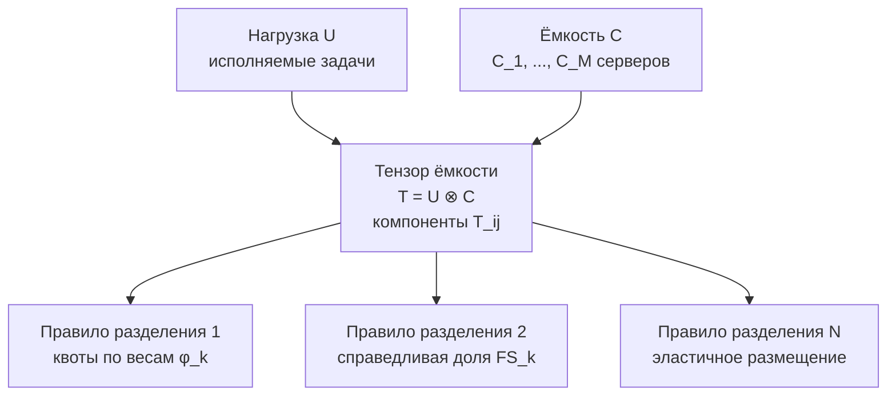

# Глава 3. Математическая модель справедливого разделения эластичной ёмкости

В главе строится математическая модель задачи справедливого разделения эластичной ёмкости вычислительного кластера между владельцами (квотами). Вводятся модель кластера и эластичности задач, понятие справедливой доли владельца, тензорное представление ёмкости кластера и критерии эффективности, включая общественное благо, приносимое эластичностью.

## 3.1 Постановка задачи

Рассматривается вычислительный кластер с множественной арендой ресурсов, обслуживающий $n$ владельцев (квот). Каждый владелец $k$ предъявляет множество задач, требования которых к ресурсам являются эластичными: задача может исполняться с любым объёмом ресурса в заданном диапазоне. Планировщик централизованно размещает задачи на узлах кластера в пределах его ёмкости.

Задача справедливого разделения эластичной ёмкости формулируется следующим образом: требуется разработать правило размещения, которое

- гарантирует каждому владельцу его справедливую долю ресурсов в пределах спроса,
- размещает задачи по приоритету в пределах ёмкости кластера,
- эффективно использует всю доступную ёмкость, в том числе за счёт эластичности нагрузки.

Далее предполагается, что узлы кластера уже заполнены методами плотной упаковки, рассмотренными в главе 2. Рассматривается этап распределения эластичной ёмкости между владельцами на уже упакованном кластере.

## 3.2 Модель кластера и эластичности задач

Рассматривается однородный кластер из $M$ узлов с суммарной ёмкостью $C$. В качестве ресурсов выступают процессоры, оперативная память и графические ускорители. Для построения модели используется упрощение: рассматривается один узел с одним типом ресурса, что позволяет отделить основные свойства задачи от влияния неоднородности оборудования.

Ключевым ограничением модели является то, что суммарная пропускная способность кластера не может быть произвольно изменена планировщиком. Зависимость пропускной способности от числа потоков-исполнителей $N$ описывается универсальным законом масштабируемости (Universal Scalability Law, USL) [[15-usl|15]]:

$$C(N) = \frac{N}{1 + \alpha(N - 1) + \beta N (N - 1)},$$

где $\alpha$ — параметр конкуренции за разделяемые ресурсы, а $\beta$ — параметр накладных расходов когерентности данных. Выведем эту формулу из закона Амдала и учёта межпроцессорной когерентности.

**Вывод (универсальный закон масштабируемости [[15-usl|15]]).** Пусть суммарная работа, выполняемая за единицу времени на $N$ потоках-исполнителях, состоит из двух частей: независимо распараллеливаемой доли и последовательной доли, требуемой для координации. По закону Амдала время выполнения одной порции работы на $N$ процессорах равно $T(N) = 1 + a\,(N-1)$, где $a$ — доля последовательных операций: при идеальном распараллеливании параллельная часть сокращается в $N$ раз, тогда как последовательная остаётся неизменной, а её вклад в $T(N)$ растёт пропорционально числу добавляемых процессоров $(N-1)$. Отсюда ускорение $C(N) = N/T(N) = N/(1 + a(N-1))$.

Дополнительно учтём накладные расходы на согласование когерентности данных. При $N$ исполнителях число упорядоченных пар, обменивающихся данными, пропорционально $N(N-1)$: каждая пара процессоров должна поддерживать согласованность разделяемого состояния, и стоимость этой синхронизации растёт с числом взаимодействующих пар. Внося эту компоненту с коэффициентом $\beta$, получаем полное время

$$T(N) = 1 + \alpha(N-1) + \beta N(N-1),$$

где параметр $\alpha$ обобщает долю последовательных операций закона Амдала, а $\beta$ — интенсивность накладных расходов когерентности. Деля идеальную производительность $N$ на $T(N)$, приходим к закону масштабируемости:

$$C(N) = \frac{N}{1 + \alpha(N - 1) + \beta N (N - 1)}.$$

Квадратичный член $\beta N(N-1)$ в знаменателе отражает ключевое отличие от закона Амдала: при достаточно большом $N$ накладные расходы когерентности растут быстрее линейного выигрыша от добавления процессоров, поэтому пропускная способность $C(N)$ достигает максимума при конечном числе исполнителей и затем убывает. Пропускная способность кластера ограничена сверху и достигает максимума при некотором конечном числе исполнителей $N$. Дальнейшее увеличение числа потоков приводит к снижению производительности из-за конкуренции и накладных расходов на согласование (рис. 3.1). Отсюда следует принципиальный вывод: планировщик и механизмы справедливого разделения **не увеличивают суммарную пропускную способность кластера**, а лишь перераспределяют фиксированную, ограниченную законом USL ёмкость между владельцами. Это ограничение является фундаментальным для постановки задачи: справедливое разделение оперирует заданной, не изменяемой суммарной ёмкостью.

<small>Рис. 3.1. Универсальный закон масштабируемости $C(N)$: пик при конечном $N$, затем спад из-за накладных расходов когерентности.</small>

Задача $i$ характеризуется потреблением ресурса $x_i$. Эластичность задачи означает, что она может принимать любой объём ресурса в заданном диапазоне:

$$x_i \in \{0\} \cup [x_{\min}, x_{\max}],$$

где $x_{\min}$ — минимальный объём, необходимый задаче для продолжения работы, а $x_{\max}$ — максимальный объём, который она способна использовать. Планировщик вправе сжимать и расширять задачу в этих границах, подстраивая её под свободную ёмкость.

Размещение нагрузки управляется системой приоритетов: задачи с более высоким приоритетом размещаются в первую очередь. Формально приоритетное размещение в пределах ёмкости описывается задачей оптимизации

$$\max_x \sum_{i=1}^{n} c_i x_i,$$

при ограничениях

$$\sum_{i=1}^{n} x_i \leq C,$$

$$x_i \in \{0\} \cup [x_{\min}, x_{\max}],$$

где $c_i$ — приоритет задачи $i$. Для случая одного владельца решение строится следующим образом. Задачи упорядочиваются по убыванию приоритета $c_i$. Размещение выполняется в этом порядке до заполнения ёмкости $C$. После этого в обратном порядке происходит расширение нагрузки до максимума в пределах диапазона $[x_{\min}, x_{\max}]$ и доступной ёмкости. Эластичность позволяет планировщику адаптировать нагрузку согласно иерархии приоритетов, а введение приоритетов даёт возможность выполнять размещение за $O(N \log N)$ операций. Отметим, что приведённая программа служит формальным описанием цели: разработанный в главе 4 алгоритм решает лексикографическую задачу — приём задач в порядке приоритета, — а не максимизацию взвешенного объёма $\sum_i c_i x_i$ (раздел 4.3).

## 3.3 Справедливая доля владельцев на основе квот

Совместное использование кластера множеством владельцев требует задания правил справедливого разделения ёмкости. Справедливая доля владельца $k$ задаётся пропорционально его весу $\phi_k$ в пределах квоты $Q_k$ (предельного объёма ёмкости, доступного владельцу):

$$FS_k = \frac{\phi_k}{\sum_{j=1}^{n} \phi_j} Q_k, \quad k = 1, \dots, n,$$

где $\phi_k$ — вес владельца $k$. Гарантия справедливости состоит в том, что каждый владелец получает свою справедливую долю в пределах спроса:

$$A_k \geq \min(FS_k,\, D_k),$$

где $A_k$ — фактически выделенная владельцу $k$ ёмкость, а $D_k$ — спрос владельца (суммарный минимальный объём его задач). При $D_k \geq FS_k$ гарантия принимает вид $A_k \geq FS_k$. Эластичность нагрузки облегчает выполнение этой гарантии: при значительной фрагментации жёсткая задача может не поместиться ни в один свободный фрагмент, тогда как эластичная сжимается до доступного объёма и запускается.

Квотирование может быть формализовано в рамках теории массового обслуживания и принципа max-min справедливости. Справедливое распределение ёмкости между владельцами сводится к выравниванию нормированных долей: в равновесии максимизируется минимальное отношение выделенного объёма к допустимому

$$\max_{\{A_k\}} \min_{k=1,\dots,n} \frac{allocated_k}{capacity_k},$$

где $allocated_k$ — объём ресурсов, выделенный владельцу $k$, а $capacity_k$ — объём, допустимый квотой владельца $k$. Такой подход переносит принцип справедливого распределения, известный для нескольких типов ресурсов (DRF, доминантные доли [[8-drf|8]]), на случай владельцев с заданными квотами: вместо максимизации минимальной доминантной доли выравнивается минимальное нормированное отношение в пределах квоты.

## 3.4 Тензорное представление ёмкости кластера

Правила организации ресурсов в облачной модели на основе линейно заданных правил обобщаются в тензорной нотации. Напомним, что тензором над полем $\mathbb{F}$ называется элемент тензорного произведения пространств, задающий полилинейное отображение на декартовом произведении этих пространств и их двойственных. Пусть в $V$ выбран базис $\{e_i\}$, в двойственном пространстве $V^*$ — сопряжённый базис $\{e^j\}$ и $T \in V \otimes_{\mathbb{F}} V^*$. Тогда

$$T = \sum_{i,j} T_{ij} \, e_i \otimes_{\mathbb{F}} e^j,$$

где $\otimes_{\mathbb{F}}$ — тензорное произведение над полем $\mathbb{F}$, а $T_{ij} \in \mathbb{F}$ — компоненты тензора в данном базисе. Сам объект $T$ не зависит от выбора базиса, поскольку при замене базиса компоненты $T_{ij}$ преобразуются с сохранением суммы.

Для кластерных вычислений поле $\mathbb{F}$ полагается равным полю действительных чисел $\mathbb{R}$. Ценность тензорной нотации применительно к рассматриваемой задаче состоит в возможности единообразного описания различных правил разделения ресурсов. Например, размещение нагрузки $V_j$ по вычислительному кластеру записывается как

$$T = U \otimes_{\mathbb{F}} C,$$

где компонента $U$ обозначает уже исполняемую нагрузку, а вектор $C = (C_1, \dots, C_M)$ задаёт ёмкости всех $M$ доступных серверов.

Схематически тензорное представление ёмкости показано на рисунке 3.2: тензор $T = U \otimes_{\mathbb{F}} C$ задаёт полилинейное отображение, связывающее размещённую нагрузку $U$ с ёмкостями серверов $C_j$, что позволяет единообразно описывать различные правила разделения ресурсов в одной записи.

<small>Рис. 3.2. Тензорное представление ёмкости кластера $T = U \otimes_{\mathbb{F}} C$.</small>

Для обобщения подхода рассмотрим модельную ситуацию разделения одинаковой реплицированной нагрузки по заданным квотам. Общий объём реплик зададим равным $N$, а ресурс одной реплики — равным $R$. Разбиение реплик по $n$ квотам $g_1, \dots, g_n$ и условие ёмкости имеют вид

$$\{1, \dots, N\} = g_1 \cup \dots \cup g_n, \qquad C = \sum_g d_g R,$$

где $d_g$ — число реплик квоты $g$. Тогда полное разделение ресурсов записывается как

$$T = \bigoplus_g R_g \oplus U,$$

где $R_g$ задают полные ресурсы, выделенные под реплики квоты $g$ без учёта эластичности, причём

$$\dim R_g = r_g \geq d_g,$$

где $r_g$ — число реплик нагрузки, ожидающих размещения в квоте $g$. Каждое из представлений ёмкости является задачей управляющей плоскости кластера.

Пусть $C_g(x)$ — ёмкость, выделяемая квоте $g$ согласно размещению $x$ (суммарная по узлам, доступным квоте $g$). Тогда итоговая ёмкость размещения без учёта эластичности равна

$$C_{no\,elastic}(x) = \sum_g \max(C_g(x)) \, d_g(x),$$

то есть каждая квота $g$ «платит» своим собственным максимумом ёмкости, который не может быть перераспределён между квотами: без эластичности реплики квоты $g$ размещаются независимо от остальных и не могут использовать ёмкость других квот. При учёте эластичности все реплики являются эластичными, поэтому свободная ёмкость разных квот может быть объединена и перераспределена:

$$C_{elastic}(x) = \max\left(\sum_g C_g(x)\, d_g(x)\right).$$

Здесь максимум по каждой квоте берётся по множеству её жёстких размещений, а внешний максимум — по множеству совместных эластичных размещений. Любое жёсткое размещение допустимо и для эластичной модели, поэтому внешняя оптимизация ведётся по большему множеству — это и создаёт содержательную разность между двумя величинами.

## 3.5 ЛП-переформулировка задачи размещения

Исходная задача размещения эластичных задач по приоритету в пределах ёмкости является комбинаторной и в общем случае не имеет точного решения за приемлемое время, поскольку сводится к NP-полной задаче партиционирования (содержит задачу плотной упаковки, bin packing, как частный случай — глава 2). Точное решение таких задач экспоненциально по числу задач, что делает их неприменимыми в реальном времени для кластеров с большим числом задач. Стандартный способ борьбы с комбинаторной сложностью — переформулировать задачу в линейное программирование (ЛП), решить релаксацию и округлить полученное решение до допустимого. На практике аппроксимационные алгоритмы на основе линейного программирования решают задачу за полиномиальное время с гарантированной оценкой точности. Для ряда задач упаковки построены и полиномиальные схемы приближения (PTAS). Такой каркас (ЛП-релаксация + округление) лежит в основе аппроксимационных алгоритмов планирования масштабируемых задач [[18-jansen-zhang|18]] и планирования на неоднородных машинах [[20-fotakis-malleable|20]].

Формальное обоснование округления дробного решения ЛП даёт классическая теорема об округлении Ленстры, Шмойса и Тардоса. Она относится к задаче минимизации длины расписания на несвязанных параллельных машинах $R \parallel C_{\max}$ [[78-lenstra-shmoys-tardos|78]]. В теореме фиксируются крайний срок $d$ и верхняя граница $t$ на время обработки отдельной работы. ЛП-релаксация задаётся переменными $x_{ij}$, означающими долю работы $j$, назначенной на машину $i$. Для каждой работы $j$ выполняется равенство $\sum_{i \in M_j(t)} x_{ij} = 1$. Для каждой машины $i$ выполняется неравенство $\sum_{j \in J_i(t)} p_{ij} x_{ij} \leq d_i$. Множество $M_j(t)$ состоит из машин, способных обработать работу $j$ за время не более $t$. Множество $J_i(t)$ состоит из работ, обрабатываемых машиной $i$ за время не более $t$.

Теорема утверждает следующее. Если релаксация разрешима, то любая её вершина округляется за полиномиальное время до целого решения. Решение удовлетворяет тем же ограничениям назначения. Бюджет машин нарушается лишь на величину $d_i + t$ вместо $d_i$. Цена округления не превышает одного времени обработки самой работы. Прирост ёмкости не превышает $t$ на машину.

Округление возможно благодаря разреженности. В силу структуры полиэдра лишь малая часть переменных дробна. Число дробных работ ограничено числом машин. Граф поддержки любой вершины является псевдолесом. В нём рёбра не превосходят узлов. Поэтому дробные работы можно досрочно назначить по паросочетанию.

На основе этой теоремы Ленстрой, Шмойсом и Тардосом построен алгоритм приближения с коэффициентом 2 для $R \parallel C_{\max}$ [[78-lenstra-shmoys-tardos|78]]. Доказано, что никакой полиномиальный алгоритм не достигает коэффициента меньше $3/2$ при условии $P \ne NP$. Для фиксированного числа машин построена полиномиальная схема приближения.

Значение этого результата для настоящей работы двоякое. Во-первых, он даёт эталонную оценку цены округления ЛП для постановок с фиксированным диапазоном времени обработки. Эта оценка аналогична по духу диапазону эластичности $[x_{\min}, x_{\max}]$. Во-вторых, он показывает, что гарантированное округление релаксации достижимо, когда структурная разреженность вершин может быть доказана. В рассматриваемой здесь постановке максимизации взвешенного объёма над политопом частичного размещения такая разреженность, как отмечено ниже, напрямую не наследуется.

Поэтому требуется отдельное обоснование.

Введём переменные $x_{i,l}$, означающие долю задачи $i$, исполняемой на $l$ процессорах, где $l = 1, \dots, m$. Тогда задача размещения по приоритету в пределах ёмкости допускает следующую ЛП-переформулировку (в духе релаксации задачи о назначениях Янсена и Чжана [[18-jansen-zhang|18]]):

$$\max_{x} \sum_{i=1}^{n} c_i \sum_{l=1}^{m} x_{i,l},$$

при ограничениях

$$\sum_{l=1}^{m} x_{i,l} \leq 1, \quad \forall i,$$

$$\sum_{i=1}^{n} \sum_{l=1}^{m} x_{i,l} \cdot l \cdot p_i(l) \leq C,$$

$$x_{i,l} \geq 0, \quad \forall i, l,$$

где $p_i(l)$ — время обработки задачи $i$ на $l$ процессорах, а $C$ — бюджет ёмкости, измеряемый в процессорном времени окна планирования. Целевая функция максимизирует суммарный взвешенный по приоритетам объём размещённой работы. Первое ограничение допускает частичное размещение задачи ($0 \leq \sum_l x_{i,l} \leq 1$), второе — что суммарная работа не превышает бюджета ёмкости.

Нормировка полного размещения $\sum_l x_{i,l} = 1$ здесь намеренно не используется. При ней каждая задача размещается полностью, поэтому $\sum_i c_i \sum_l x_{i,l} = \sum_i c_i$ — целевая функция вырождается в константу и не зависит от размещения. Допуская частичное размещение, мы сохраняем содержательность оптимизации: максимум достигается размещением наиболее приоритетных задач в пределах ёмкости.

Ключевое свойство ЛП-релаксации состоит в том, что она **полиномиально разрешима**, в отличие от исходной целочисленной задачи. Отметим, что свойство «не более двух соседних ненулевых переменных $x_{i,l}$ (для $l$ и $l+1$)» доказано в [[18-jansen-zhang|18]] для ЛП **минимизации длины расписания** с ограничениями предшествования (замечание к ЛП (10), с. 250–251) и в общем случае не переносится на рассматриваемую здесь максимизацию взвешенного объёма над политопом частичного размещения с ограничением ёмкости. Поэтому округление дробного решения в данной постановке не наследует гарантированной оценки из [[18-jansen-zhang|18]] напрямую и требует отдельного обоснования, а оценка аппроксимации ограничена областью применимости.

Сформулируем формальные свойства ЛП-релаксации, на которых основаны её применение в пакетном режиме и интеграция требований справедливости.

**Теорема 3.1 (полиномиальная разрешимость и верхняя оценка оптимума релаксации задачи о назначениях).** Релаксация задачи о назначениях (§3.5) решается за полиномиальное время. Оптимум $V_{LP}$ не меньше оптимума исходной целочисленной задачи. Верно $V_{LP} \geq V_{IP}$. Для любого допустимого размещения со значением $V$ справедливо $V \leq V_{IP} \leq V_{LP}$.

Поэтому $V_{LP}$ — верхняя оценка достижимого оптимума.

Постановка релаксации продолжает релаксацию задачи о назначениях Янсена и Чжана для malleable-задач [[18-jansen-zhang|18]]. Свойство верхней оценки оптимума — стандартное следствие ослабления целочисленности. Оно используется в аппроксимационных схемах [20, 78]. Шмойс и Тардос [[87-shmoys-tardos-gap|87]] распространили округление релаксации задачи о назначениях на произвольные дробные решения, не требующие вершинности: по заданной стоимости $C$ алгоритм либо доказывает отсутствие расписания стоимости $C$, либо строит расписание стоимости не более $C$ с загрузкой каждой машины не более $2T_i$. Это расширяет область применимости каркаса «ЛП-релаксация + округление» на постановки, где структурная разреженность вершин не гарантируется.

**Доказательство.** *Разрешимость.* Релаксация является задачей линейного программирования. Целевая функция и ограничения линейны. Число переменных равно $O(nm)$, ограничений — $O(n+m)$. Всё полиномиально по входу. Линейное программирование разрешимо за полиномиальное время методом внутренней точки (Khachian 1979, Grötschel–Lovász–Schrijver 1988).

*Верхняя граница.* Всякое допустимое целочисленное размещение является частным случаем допустимого дробного. Если задача размещена на $l$ процессорах, то $x_{i,l}=1$, остальные $x_{i,l'}=0$. Все ограничения релаксации выполнены: $\sum_l x_{i,l}=1 \le 1$ и неравенство бюджета. Следовательно, множество допустимых решений целочисленной задачи содержится в множестве допустимых решений релаксации. Максимум по большему множеству не меньше максимума по меньшему.

Поэтому $V_{LP} \geq V_{IP}$.

*Верхняя оценка для любого размещения.* Любое допустимое размещение $x$ не превосходит оптимума $V_{IP}$. По пункту «верхняя граница» $V_{IP}$ не превосходит $V_{LP}$.

Отсюда $V \leq V_{IP} \leq V_{LP}$.

Значит, $V_{LP}$ ограничивает оптимум сверху. Разность $V_{LP}-V_{IP}$ (integrality gap) — максимальная погрешность округления релаксации. Планировщик получает оценку сверху на оптимум, не решая NP-трудную целочисленную задачу. ∎

**Теорема 3.2 (встроенная справедливость через квоты).** Добавим к релаксации поквотные ограничения $\sum_{i \in O_k} \sum_l x_{i,l} \cdot l \cdot p_i(l) \leq Q_k$ для $k=1,\dots,n$. Они сохраняют линейность и полиномиальную разрешимость. Всякое решение релаксации не превышает квоту владельца $k$ по суммарной занятой ёмкости. При разрешимости релаксации с квотными ограничениями существует допустимое дробное размещение, уважающее все квоты. Способ интеграции справедливости поквотными ограничениями продолжает принцип доминирующих долей (DRF) Годси и соавторов [[8-drf|8]]. Он переносит выравнивание нормированных долей в полиэдральную постановку релаксации.

**Доказательство.** Квотное ограничение — линейное ограничение по переменным $x_{i,l}$. Оно добавляется к релаксации без изменения линейности и числа переменных. Разрешимость сохраняется. Множество допустимых решений сужается до полиэдра. Полиэдр решается за полиномиальное время.

Для всякого допустимого решения суммарная ёмкость, занятая задачами владельца $k$, равна левой части квотного ограничения. Она не превосходит $Q_k$.

Поэтому квота не нарушена.

Если релаксация с квотными ограничениями разрешима, найденное решение есть допустимое размещение. Оно уважает квоты всех владельцев.

Связь с гарантией $A_k \geq \min(FS_k, D_k)$ (раздел 3.3). Если релаксация с квотами разрешима при $\sum_k \min(FS_k, D_k) \le C$, справедливая доля достижима на уровне дробного решения. Необходимое условие приведено в доказательстве теоремы 4.2. Целочисленность и гарантия в пределах спроса требуют округления. В данной постановке (максимизация взвешенного объёма над политопом частичного размещения) оно не наследует разреженности ЛП из [[18-jansen-zhang|18]].

Поэтому округление выносится за рамки релаксации. ∎

Ценность ЛП-переформулировки особенно заметна в **пакетном режиме** планирования, когда планировщик обрабатывает пакет задач как единое целое:

- **Много задач за один раз.** В пакетном режиме на вход планировщика поступает набор из $n$ задач, и ЛП-релаксация решается за полиномиальное время по всей совокупности сразу, а не задача за задачей. Это устраняет квадратичный эффект последовательного жадного размещения.
- **Гарантия качества.** ЛП-релаксация даёт верхнюю границу на оптимум (в задаче максимизации) и, после округления, нижнюю границу на достижимое значение. Тем самым планировщик получает не только само размещение, но и **оценку сверху на оптимум** — что невозможно при чисто эвристическом размещении.
- **Встроенная справедливость.** Ограничение ёмкости $C$ и веса $c_i$ могут быть разбиты по владельцам: добавление ограничений $\sum_{i \in O_k} \sum_l x_{i,l} \cdot l \cdot p_i(l) \leq Q_k$ на квоту владельца $k$ непосредственно в ЛП гарантирует справедливую долю в пределах спроса (раздел 3.3) уже на этапе релаксации.
- **Переиспользование решений.** При поступлении нового пакета релаксация может быть решена заново от предыдущего решения (тёплый старт), что ускоряет планирование в потоковом режиме.

Таким образом, ЛП-переформулировка превращает NP-трудную комбинаторную задачу в полиномиально разрешимую релаксацию с естественной интеграцией требований справедливости. Само размещение и верхняя оценка оптимума релаксации доступны и без дополнительного обоснования округления, что делает ЛП-подход эффективным инструментом именно в пакетном режиме планирования.

## 3.6 Критерии эффективности и общественное благо

Польза использования эластичности ресурсов выражается разностью эффективной ёмкости кластера с учётом и без учёта эластичности:

$$B(x) = C_{elastic}(x) - C_{no\,elastic}(x) = \max\left(\sum_g C_g(x)\, d_g(x)\right) - \sum_g \max(C_g(x))\, d_g(x) \geq 0.$$

Неотрицательность разности следует из того, что эластичное размещение является ослаблением жёсткого: любой набор жёстких размеров задач допустим и для эластичной модели, поэтому множество допустимых эластичных размещений содержит все жёсткие и максимум по нему не меньше. Таким образом, учёт эластичности в квотах приносит неотрицательное общественное благо при справедливом разделении ресурсов: возможность сокращения части нагрузки позволяет заполнить фрагментированную ёмкость, недоступную жёсткому размещению.

Критерий эффективности может быть дополнен теоретико-игровой интерпретацией. Польза кооперации в кластере описывается функцией

$$H(x) = \frac{1}{n} \sum_{i=1}^{n} H_i(x),$$

где $H_i(x)$ — функция пользы $i$-го владельца. Сравнение кооперативной и конкурентной стратегий выполняется с помощью метрики цены анархии [[9-gubko-novikov|9]]. Для вычислительного кластера эта метрика интерпретируется как экономия на ресурсах, которые владельцы закупили бы в отдельности для удовлетворения своих потребностей. Учёт этих критериев позволяет оценивать не только справедливость, но и эффективность разрабатываемых правил размещения. Подробный теоретико-игровой анализ проводится в главе 5.

## 3.7 Заключение главы 3

В главе построена математическая модель справедливого разделения эластичной ёмкости вычислительного кластера. Введена модель однородного кластера с ёмкостью $C$. Введена модель эластичной задачи $x_i \in \{0\} \cup [x_{\min}, x_{\max}]$. Введена задача размещения по приоритету в пределах ёмкости. Она решается за $O(N \log N)$. Определена справедливая доля владельца на основе квот. Гарантируется $A_k \geq \min(FS_k, D_k)$ в пределах спроса. Предложено тензорное представление ёмкости кластера. Доказаны свойства ЛП-релаксации. Среди них полиномиальная разрешимость, верхняя оценка оптимума и встроенная справедливость через квоты (теоремы 3.1, 3.2). Показано, что учёт эластичности при справедливом разделении приносит неотрицательное общественное благо: $B(x) \geq 0$.

Полученная модель образует основу для разработки алгоритмов размещения эластичных задач (глава 4). Она также образует основу для их теоретико-игрового анализа (глава 5).