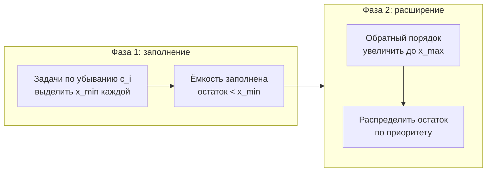

# Глава 4. Алгоритмы размещения эластичных задач

В главе разрабатываются алгоритмы размещения эластичных задач по приоритету в пределах ёмкости кластера. Вводится постановка задачи размещения, описывается техника заметания, проводится анализ вычислительной сложности и оптимальности, а также рассматривается обобщение на случай нескольких владельцев с учётом справедливого разделения ёмкости.

## 4.1 Размещение по приоритету в пределах ёмкости

Размещение нагрузки в кластере управляется системой приоритетов: задачи с более высоким приоритетом размещаются в первую очередь. С учётом модели главы 3 задача размещения формулируется как задача оптимизации

$$\max_x \sum_{i=1}^{n} c_i x_i,$$

при ограничениях

$$\sum_{i=1}^{n} x_i \leq C,$$

$$x_i \in \{0\} \cup [x_{\min}, x_{\max}],$$

где $c_i$ — приоритет задачи $i$, $C$ — ёмкость кластера, а $x_{\min}$ и $x_{\max}$ — границы диапазона эластичности задачи.

Наивное размещение сталкивается с двумя проблемами фрагментации.

**Крупные задачи с низким приоритетом.** Крупные задачи с малым приоритетом трудно разместить: фрагментация не оставляет для них места, и они голодают. Даже при наличии суммарно достаточной свободной ёмкости такая задача может не поместиться ни на один узел.

**Справедливое размещение как минимум невязки.** Распределения задач у владельцев различаются, поэтому наивное размещение, не учитывающее эти различия, нарушает справедливость. Справедливое размещение достигается как минимум невязки между фактически выделенной и требуемой долями владельцев.

Обе проблемы мотивируют разработку алгоритма, который размещает эластичные задачи по приоритету и одновременно учитывает справедливость разделения ёмкости между владельцами.

## 4.2 Техника заметания

Для решения задачи размещения по приоритету применяется техника заметания (sweep): однократный проход по задачам, упорядоченным по приоритету, с адаптацией нагрузки к свободной ёмкости. Рассмотрим сначала случай одного владельца.

Алгоритм размещения для одного владельца:

1. Упорядочить задачи по убыванию приоритета $c_i$.
2. Размещать задачи в этом порядке, выделяя каждой задаче объём, достаточный для размещения, до заполнения ёмкости $C$.
3. После заполнения ёмкости в обратном порядке расширять нагрузку до максимума $x_{\max}$ в пределах диапазона эластичности и доступной ёмкости.

Соответствующая псевдокод-процедура имеет следующий вид.

```
Вход:  задачи (c_i, x_min, x_max), ёмкость C
1:  отсортировать задачи по убыванию c_i            # O(N log N)
2:  остаток := C
3:  для каждой задачи i в порядке убывания c_i:     # фаза заполнения
4:      если остаток < x_min[i]:
5:          перейти к следующей задаче
6:      x_i := min(x_min[i], остаток)
7:      остаток := остаток - x_i
8:  для каждой задачи i в обратном порядке:          # фаза расширения
9:      если x_i > 0:
10:         прирост := min(x_max[i] - x_i, остаток)
11:         x_i := x_i + прирост
12:         остаток := остаток - прирост
13: вернуть размещение (x_i)
```

Эластичность позволяет планировщику адаптировать нагрузку согласно иерархии приоритетов: на фазе заполнения размещается максимально возможное число задач в порядке приоритета, а на фазе расширения остаточная ёмкость распределяется обратно по приоритету, обеспечивая наиболее ценным задачам максимальный доступный объём ресурса.

Две фазы алгоритма заметания — заполнение и расширение — показаны на рисунке 4.1.


<small>Рис. 4.1. Две фазы алгоритма заметания: заполнение и расширение.</small>

## 4.3 Анализ вычислительной сложности и оптимальности

Алгоритм заметания состоит из двух стадий: сортировки задач и двух линейных проходов. Сортировка выполняется за $O(N \log N)$ операций, а обе фазы заметания — за $O(N)$. Таким образом, суммарная вычислительная сложность алгоритма составляет $O(N \log N)$.

**Важно уточнить фактическую цель алгоритма заметания.** При диапазоне эластичности $x_i \in \{0\} \cup [x_{\min}, x_{\max}]$ двухфазный жадный алгоритм (заполнение всех $x_{\min}$ по убыванию $c_i$, затем обратное расширение) максимизирует **число размещённых задач** (приём) в порядке приоритета, а **не** взвешенный объём $\sum_i c_i x_i$. Эти две цели не совпадают: из-за нижней границы $x_{\min}$ задача является непрерывной задачей о ранце с «порогом» включения, где жадное заполнение всех минимумов принудительно тратит ёмкость на задачи с меньшим $c_i$. Контрпример: $C=100$, задача A $(c=100, x_{\min}=40, x_{\max}=100)$, задача B $(c=95, x_{\min}=60, x_{\max}=60)$. Алгоритм даёт $x_A=40$, $x_B=60$, значение $100\cdot40 + 95\cdot60 = 9700$. Оптимум $x_A=100$, $x_B=0$ даёт $100\cdot100 = 10000 > 9700$. Таким образом, для цели $max \sum_i c_i x_i$ алгоритм заметания **неоптимален**. Точная оптимизация взвешенного объёма требует ЛП-подхода раздела 3.5.

**Теорема 4.1 (оптимальность заметания по приёму в порядке приоритета).** Пусть задачи упорядочены по невозрастанию приоритета $c_1 \geq c_2 \geq \dots \geq c_N$ и каждая задача $i$ характеризуется минимальным объёмом ресурса $x_{\min,i}$. Жадный алгоритм фазы заполнения, принимающий задачу $i$ тогда и только тогда, когда $x_{\min,i}$ не превосходит оставшейся ёмкости, возвращает допустимый набор принятых задач, **лексикографически максимальный** в порядке приоритета. Среди всех допустимых наборов, лексикографически наилучших по приоритету, он максимизирует число принятых задач. Вычислительная сложность фазы — $O(N \log N)$. Постановка приёма в пределах ёмкости без знания будущих поступлений и её анализ продолжают линию онлайн-рюкзака (рюкзачной секретарской задачи Бабайоффа и соавторов [[73-knapsack-secretary|73]]).

**Доказательство.** Пусть $G$ — набор задач, принятых жадным алгоритмом. Пусть $T$ — произвольный допустимый набор, $\sum_{i \in T} x_{\min,i} \leq C$ и $T \neq G$. Предположим противное. А именно, $T$ лексикографически больше $G$. Значит, вектор индикаторов принятия $T$ превосходит вектор $G$ в первой позиции, где они различаются. Пусть $k$ — первый такой индекс. Тогда $k \in T$ и $k \notin G$. Для всех $i < k$ индикаторы совпадают.

Жадный алгоритм не принял задачу $k$. Поэтому в момент её рассмотрения оставшаяся ёмкость была строго меньше $x_{\min,k}$:

$$\sum_{i \in G,\; i < k} x_{\min,i} + x_{\min,k} > C.$$

Наборы $G$ и $T$ совпадают на всех $i < k$. Следовательно,

$$\sum_{i \in T} x_{\min,i} \geq \sum_{i \in T,\; i \leq k} x_{\min,i} = \sum_{i \in G,\; i < k} x_{\min,i} + x_{\min,k} > C.$$

Это противоречит допустимости $T$.

Значит, ни один допустимый набор не лексикографически больше $G$. Набор $G$ лексикографически максимален.

Из лексикографической максимальности следует максимум числа принятых задач. Лексикографическое упорядочение сначала включает старшие по приоритету задачи. Среди наборов, совпадающих на всех старших, оно включает следующие. В итоге получается максимально возможное число принятых задач при данном приоритетном порядке.

**Оценка сложности.** Сортировка по убыванию $c_i$ занимает $O(N \log N)$. Один проход по задачам с поддержанием остатка ёмкости занимает $O(N)$. Итоговая сложность фазы заполнения равна $O(N \log N)$. ∎

Заявление об оптимальности в разделе относится именно к максимизации приёма в порядке приоритета (теорема 4.1), а не к взвешенному объёму.


<small>Рис. 4.2. Контрпример §4.3: алгоритм заметания даёт $9700$ вместо оптимума $10000$.</small>

Дополнительно отметим, что фаза расширения не меняет набора размещённых задач, а лишь распределяет остаточную ёмкость, поэтому она сохраняет состав размещённой нагрузки. В сочетании с гарантией справедливой доли (глава 3) это позволяет применять алгоритм как в сценарии одного, так и нескольких владельцев.

## 4.4 Случай нескольких владельцев

В случае нескольких владельцев размещение выполняется в пределах квот с учётом справедливой доли каждого владельца $FS_k$, заданной пропорционально весу $\phi_k$ (глава 3). Задачи владельца размещаются по приоритету, а суммарный объём, выделенный владельцу, ограничивается его долей в пределах спроса.

Пусть $O_k$ — множество задач, принадлежащих владельцу $k$, а $A_k = \sum_{i \in O_k} x_i$ — суммарный объём, выделенный владельцу $k$. Справедливость размещения требует выполнения гарантии $A_k \geq \min(FS_k, D_k)$ для каждого владельца $k$, где $D_k$ — спрос владельца (суммарный минимальный объём его задач).

Различия в распределении задач между владельцами приводят к тому, что наивное размещение нарушает справедливость: при заполнении ёмкости по глобальному приоритету некоторые владельцы могут получить меньше своей справедливой доли. Для восстановления справедливости применяется правило минимальной невязки: ресурсы, оставшиеся после размещения по приоритету, распределяются между владельцами в порядке убывания отклонения фактически выделенной доли от справедливой доли $FS_k$. Формально владельцы упорядочиваются по величине невязки

$$\Delta_k = FS_k - A_k,$$

и остаточная ёмкость выделяется в порядке убывания $\Delta_k$. Это позволяет выполнить гарантию справедливой доли в пределах спроса для каждого владельца.

**Теорема 4.2 (достижимость гарантии справедливой доли).** Пусть суммарная ёмкость кластера удовлетворяет условию $C \geq \sum_k \min(FS_k, D_k)$ и задачи владельцев эластичны в диапазоне $[x_{\min}, x_{\max}]$. Тогда правило минимальной невязки (дозаполнение остаточной ёмкости владельцам в порядке убывания $\Delta_k$ вплоть до их спроса $D_k$) достигает гарантии справедливой доли $A_k \geq \min(FS_k, D_k)$ для каждого владельца $k$. Правило минимальной невязки реализует водонаполнение (water-filling) доминирующих долей, введённое в DRF Годси и соавторов [[8-drf|8]], в многомерной постановке с квотами и эластичностью.

**Доказательство.** Разобьём доказательство на два шага. Первый шаг — совместимость целевых объёмов с ёмкостью. Второй шаг — корректность правила минимальной невязки.

*Шаг 1 (совместимость целевых объёмов с ёмкостью).* Сумма целевых объёмов по всем владельцам не превосходит ёмкости кластера:

$$\sum_{k=1}^{n} \min(FS_k, D_k) \leq \sum_{k=1}^{n} FS_k = \sum_{k=1}^{n} \frac{\phi_k}{\sum_j \phi_j} Q_k \leq C.$$

Первое неравенство использует $\min(FS_k, D_k) \leq FS_k$. Последнее неравенство — условие достаточной ёмкости. Следовательно, суммарный объём, который обязаны получить владельцы, укладывается в ёмкость.

*Шаг 2 (корректность правила минимальной невязки).* Правило выделяет остаточную ёмкость владельцу с наибольшей текущей невязкой $\Delta_k = \min(FS_k, D_k) - A_k > 0$. Выделение идёт вплоть до спроса $D_k$. Покажем, что процесс не застревает до достижения всех целей.

Пусть на некотором шаге осталось хотя бы одно значение $\Delta_k > 0$. Тогда $A_k < \min(FS_k, D_k) \leq D_k$. Значит, владелец $k$ ещё не исчерпал свой спрос $D_k$. У него есть задачи, которые можно расширить в пределах диапазона эластичности до $\min(FS_k, D_k)$. Следовательно, существует ёмкость, которую можно выделить владельцу $k$ без нарушения допустимости. Выбор владельца с максимальной невязкой всегда возможен. Суммарный целевой объём $\sum_k \min(FS_k, D_k) \leq C$.

Поэтому процесс завершается не ранее, чем все невязки обратятся в ноль. Правило останавливается, когда $A_k = \min(FS_k, D_k)$ для всех $k$.

Дозаполнение идёт вплоть до спроса $D_k$, а не до $FS_k$. Если $FS_k > D_k$, владелец физически не может получить больше своего спроса. Целевой объём равен $\min(FS_k, D_k) = D_k$. Если же $FS_k \leq D_k$, целевой объём равен $FS_k$. Владелец получает свою справедливую долю в пределах имеющегося спроса.

В обоих случаях достигается гарантия $A_k \geq \min(FS_k, D_k)$. ∎

Условие $C \geq \sum_k \min(FS_k, D_k)$ необходимо и достаточно для одновременной выполнимости всех гарантий: при его нарушении суммарных целевых объёмов больше ёмкости, и хотя бы один владелец недополучит долю. Эластичность здесь существенна: при жёстких (rigid) задачах дозаполнение может оказаться невозможным из-за фрагментации, тогда как эластичная задача сжимается/расширяется в пределах $[x_{\min}, x_{\max}]$, делая дозаполнение реализуемым. Выбор владельца с максимальной невязкой не обязателен для достижения гарантий (любой порядок дозаполнения вплоть до спроса сработает). Он важен для дополнительного свойства — минимизации максимальной относительной недополученной доли по владельцам, что соответствует принципу max-min справедливости из §3.3.

Эластичность существенно облегчает размещение в многопользовательском случае, поскольку позволяет подстроить нагрузку под свободную ёмкость и разместить задачи из очередей с малыми ресурсами. Правило эластичности учитывается не только на уровне узла, но и на уровне квоты: приоритет квоты повышается с учётом возможности сокращения ресурса её эластичной нагрузки, что повышает эффективную ёмкость (утилизацию) кластера.

## 4.5 Теоретические возможности эластичных нагрузок

Эластичность нагрузки открывает теоретические возможности улучшения трёх ключевых показателей системы — энергопотребления, справедливости и длины расписания — но одновременно порождает и ряд вызовов. Рассмотрим их по отдельности.

**Энергосбережение.** Мощность, потребляемая задачей на $l$ процессорах при тактовой частоте $v$, пропорциональна кубу частоты: $P(v) \propto v^3$. Для эластичной задачи энергия, затраченная на выполнение суммарной работы $w_i$, равна произведению мощности на время, $E_i = \int_0^{T_i} P(v(t))\,dt$. Как показано в разделе 2.2 (свойство Фишера с соавторами [[19-fisher-energy|19]]), при однородной частоте на всех ядрах оптимальная по энергии стратегия использует постоянную частоту. Эластичность усиливает этот эффект: сжимая задачу до меньшего числа процессоров $l$ и пропорционально увеличивая время её исполнения, планировщик снижает суммарное потребление энергии, поскольку мощность растёт быстрее линейно. Формально при переходе с $l_1$ на $l_2 < l_1$ процессоров время исполнения возрастает (сублинейное ускорение), однако суммарная энергия, как правило, уменьшается. Это делает эластичность инструментом энергосбережения: задачу можно «растянуть во времени», снизив пиковую мощность и энергопотребление ценой увеличения длины расписания.

**Справедливость.** Эластичность облегчает выполнение гарантии справедливой доли в пределах спроса (раздел 3.3). При фиксированных требованиях нагрузки справедливое распределение упирается в фрагментацию: суммарно достаточная ёмкость может быть недоступна ни одному владельцу целиком. Эластичная задача допускает сжатие в пределах диапазона $[x_{\min}, x_{\max}]$, что позволяет планировщику «доразместить» невыполненные части доли $FS_k$, подстраивая каждую задачу под свободную ёмкость. Тем самым эластичность повышает достижимость справедливого распределения при той же суммарной ёмкости кластера.

**Минимизация длины расписания.** Эластичность сокращает длину расписания, устраняя потери на фрагментацию: жёсткая задача, не поместившаяся ни в один свободный фрагмент, ожидает в очереди, тогда как эластичная сжимается и запускается. Поскольку суммарная ёмкость кластера фиксирована законом USL [[15-usl|15]] и не может быть увеличена планировщиком, эластичность не сокращает длину расписания за счёт добавления ресурсов, а лишь эффективно использует уже доступную ёмкость. Теоретически это даёт выигрыш против жёстких политик: как показано для эластичных (malleable) нагрузок в [[21-elastisim|21]], учёт эластичности сокращает длину расписания на 18–21% относительно жёстких версий тех же политик.

**Сопутствующие вызовы.** Перечисленные выгоды достигаются ценой ряда трудностей. Во-первых, сжатие задачи до $x_{\min}$ увеличивает время её исполнения и может нарушить требования качества обслуживания. Следовательно, диапазон эластичности должен согласовываться с SLA владельца. Во-вторых, адаптивное изменение ресурсов в ходе исполнения требует накладных расходов на перепланирование и синхронизацию (перераспределение потоков, миграция состояния), что в пределе снижает выигрыш. В-третьих, вытесняющий характер перераспределения (раздел 1.3) может приводить к голоданию длинных низкоприоритетных задач, если не ограничивать число вытеснений. Эти вызовы ограничивают практическую ценность эластичности и учитываются при выборе диапазона $[x_{\min}, x_{\max}]$ и политики приоритетов.

### 4.5.1 Снижение объёма занимаемой памяти средствами сборщика мусора

Эластичность вычислительной нагрузки рассматривается здесь как следствие компромисса между интенсивностью очистки памяти сборщиком мусора и допустимой фрагментацией памяти относительно объёма живых данных. Обзор основных техник сборки мусора — отслеживания ссылок (reference counting), пометки и заметания (mark-sweep), пометки и уплотнения (mark-compact), копирующей и поколенческой сборки — дан в работе [[44-wilson-gc|44]]. В ней низкие паузы приписываются прежде всего инкрементальным сборщикам («Incremental techniques can keep garbage collection pause times short»), тогда как поколенческие схемы, собирающие мусор в меньшей области чаще и эксплуатирующие типичное время жизни объектов, лишь смягчают проблему пауз, а полные (полногенерационные) сборки могут давать существенно более длинные паузы (§2.7 в [[44-wilson-gc|44]]). Для рассматриваемой модели существенно не столько значение пауз, сколько сокращение пикового объёма занимаемой памяти. Механизм очистки поколений разделяет память на молодое и старое поколения и периодически переносит живые объекты из молодого поколения в старое, освобождая молодые области. В сборщиках современных языков с автоматическим управлением памятью, в частности в Go (параллельная пометка с одновременной очисткой), это позволяет снизить пиковый объём памяти, занимаемой задачей, без изменения её логики. Сборщики мусора виртуальной машины Java иллюстрируют компромисс между паузами и фрагментацией. Сборщик CMS (Concurrent Mark-Sweep) выполняет пометку и заметание параллельно с полезными вычислениями, что удерживает паузы краткими. Однако CMS не уплотняет память: свободная память фрагментируется, и при исчерпании резерва выполняется полная остановка потоков. Сборщик G1 (Garbage-First) делит память на области, собирает их в порядке убывания доли мусора и уплотняет память переносом живых объектов. Паузы ограничиваются заданным целевым значением, а фрагментация не накапливается. Выбор сборщика определяет, насколько агрессивно можно сократить пиковый объём памяти $m_i$ без чрезмерных накладных расходов на очистку. Пусть задача $i$ потребляет $m_i$ памяти. Минимальный объём ресурса, требуемый задаче для продолжения работы, пропорционален объёму занимаемой памяти: $x_{\min} \sim m_i$. Освобождая неиспользуемые данные, сборщик мусора уменьшает $m_i$, а с ней нижнюю границу диапазона эластичности $x_{\min}$: очистка памяти действует как «внутренняя эластичность» задачи, позволяя планировщику сжимать её сильнее и размещать больше задач в кластере. Однако это достигается ценой увеличения использования процессора: пометка и перенос живых объектов требуют дополнительных процессорных циклов, причём сборщик запускается тем чаще, чем меньше памяти выделено задаче. При фиксированном объёме работы $w_i$ снижение $m_i$ увеличивает долю процессорного времени, затрачиваемую на очистку, и замедляет полезное вычисление. Возникает задача нахождения компромисса: выбрать интенсивность очистки поколений так, чтобы сбалансировать высвобождаемую ёмкость кластера и накладные расходы на очистку памяти при фиксированной допустимой доле неиспользуемых данных относительно живого множества.

Актуальность такой постановки связана с современными достижениями в области бригадного планирования при обучении нейросетевых моделей на графических ускорителях. Жёсткие ограничения бригадного планирования, требующие одновременного запуска всех частей задачи, делают классические алгоритмы упаковки в контейнеры неэффективными и приводят к появлению нагрузок, не поддающихся размещению из-за несовместимости доступных фрагментов ресурса. В этих условиях способность масштабировать потребление памяти ценой роста загрузки процессора становится практически значимой, превращая память в дополнительное измерение эластичности наряду с числом процессоров.

Эластичность по памяти дополняет эластичность по числу процессоров и может быть учтена в модели главы 3 расширением диапазона $[x_{\min}, x_{\max}]$ на ресурс памяти.

## 4.6 Заключение главы 4

В главе разработаны алгоритмы размещения эластичных задач по приоритету в пределах ёмкости кластера. Основа алгоритмов — техника заметания. Доказана лексикографическая оптимальность фазы заполнения по приёму в порядке приоритета (теорема 4.1). Доказана достижимость гарантии справедливой доли правилом минимальной невязки (теорема 4.2). Показано, что введение приоритетов позволяет выполнять размещение за $O(N \log N)$ операций. Алгоритм учитывает две проблемы фрагментации. Это голодание крупных низкоприоритетных задач и нарушение справедливости при наивном размещении. Алгоритм обобщается на случай нескольких владельцев с гарантией справедливой доли в пределах спроса.

Рассмотрены теоретические возможности эластичных нагрузок. Показатели — энергосбережение, справедливость и минимизация длины расписания. Рассмотрены и сопутствующие вызовы. Рассмотрена роль очистки поколений сборщиком мусора в снижении объёма занимаемой памяти. Она выступает дополнительным источником эластичности. Полученные алгоритмы образуют основу для теоретико-игрового анализа (глава 5). Они также образуют основу для экспериментальной оценки (глава 6).